# Awesome Claude Motion Video

[](https://awesome.re)   [](LICENSE)

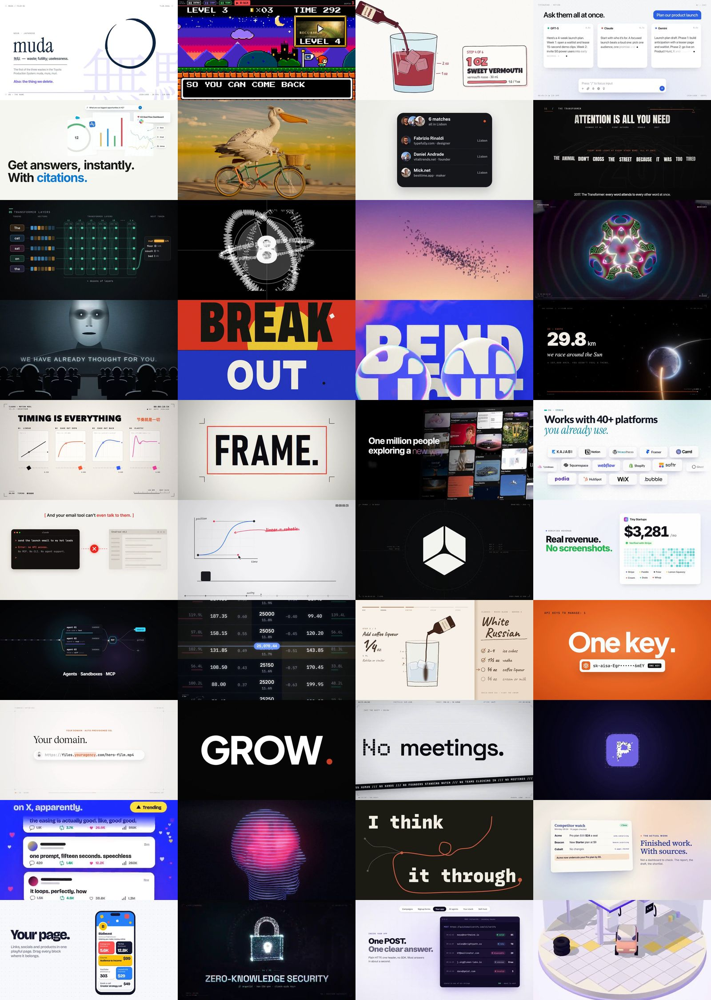

A curated list of **motion graphics videos made with Claude**, mostly **Claude Opus 5.5**: product launch films, UI motion with real text, logo reveals, kinetic type and explainers. Claude writes each one as code (HTML, SVG, React, Remotion, Three.js or Blender driven from Python, with music synthesized in Python or JavaScript) and renders it to an MP4; none of them use a video model. Only the polished ones made it in. Each is credited to its maker and linked to the post where they shared it, and where the maker published the prompt, it's copied here word for word.

**43 videos · 42 with prompts** · Updated 2026-11-12

Our other lists: **[awesome-claude-fable-videos](https://github.com/ummydev/awesome-claude-fable-videos)** (3D worlds and short films) and **[awesome-claude-fable-games](https://github.com/ummydev/awesome-claude-fable-games)**.

## Contents

- [All videos](#all-videos)
- [Product launch films](#product-launch-films) (22)
- [Logo reveals and brand films](#logo-reveals-and-brand-films) (4)
- [Showreels and kinetic type](#showreels-and-kinetic-type) (12)
- [Explainers](#explainers) (5)
- [The prompt everyone copied](#the-prompt-everyone-copied)
- [How we pick and score](#how-we-pick-and-score)
- [Add a video](#add-a-video)
- [Credits and removal](#credits-and-removal)

## All videos

Sorted by our score, then by likes on the original post. Click a frame to jump to the details.

| | Video | Maker | Likes | Views | Score |
|---|---|---|---|---|---|
| <a href="#inference-startup-launch">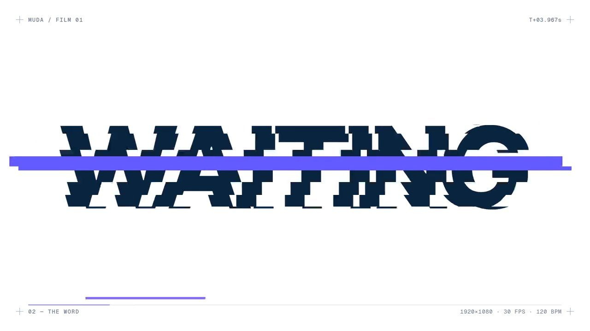</a> | **[Muda: a launch film for an inference startup, in one minute for about $2](#inference-startup-launch)**<br><sub>Product launch films</sub> | [Deedy](https://x.com/deedydas) | 3.3K | 353.9K | 10/10 |
| <a href="#recursion-nine-styles">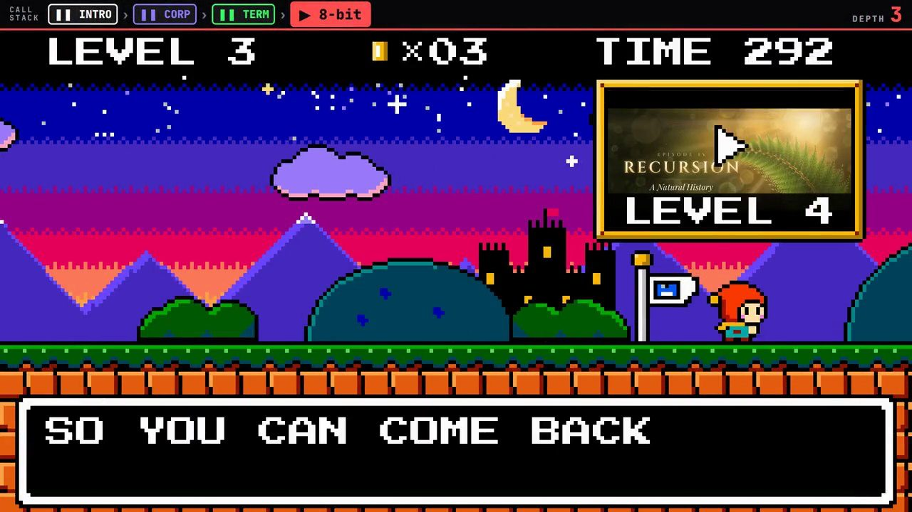</a> | **[Recursion, explained in nine genres](#recursion-nine-styles)**<br><sub>Explainers</sub> | [Ethan Mollick](https://x.com/emollick) | 560 | 71.6K | 10/10 |
| <a href="#negroni-recipe">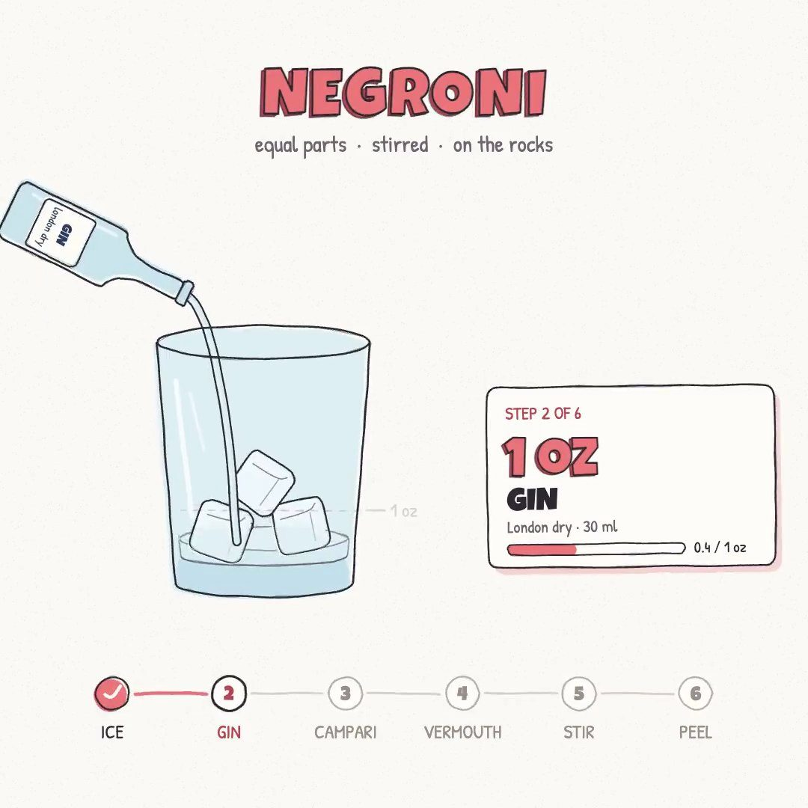</a> | **[A Negroni, poured step by step](#negroni-recipe)**<br><sub>Explainers</sub> | [Rory Flynn](https://x.com/Ror_Fly) | 1K | 81.2K | 9/10 |
| <a href="#typingmind-launch">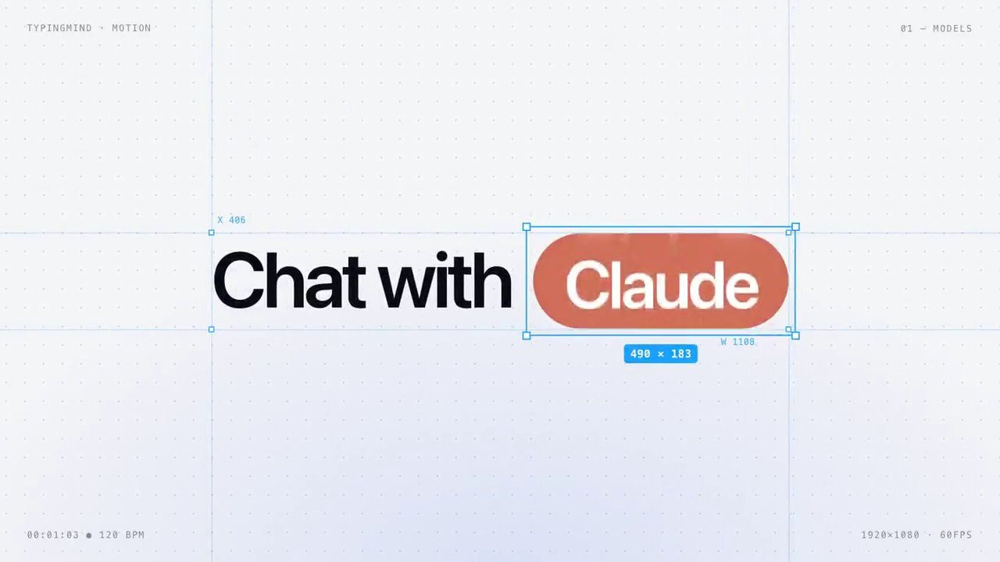</a> | **[TypingMind: one prompt instead of four weeks with freelancers](#typingmind-launch)**<br><sub>Product launch films</sub> | [Ann Nguyen](https://x.com/ann_nnng) | 984 | 102.8K | 9/10 |
| <a href="#notion-launch-it-picked">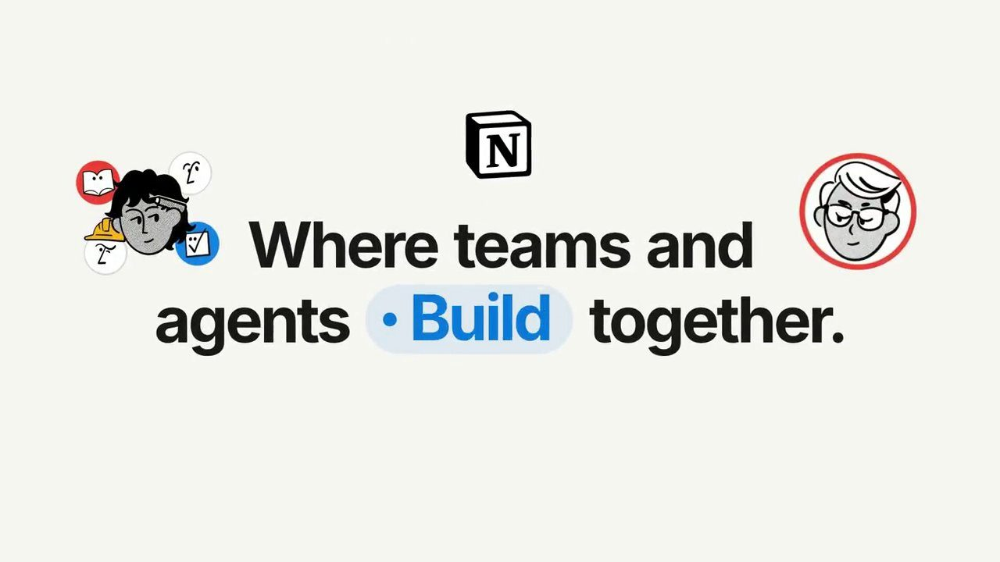</a> | **[A Notion launch film, product picked by Opus](#notion-launch-it-picked)**<br><sub>Product launch films</sub> | [Moritz Kremb](https://x.com/moritzkremb) | 444 | 100.3K | 9/10 |
| <a href="#pelican-riding-a-bicycle">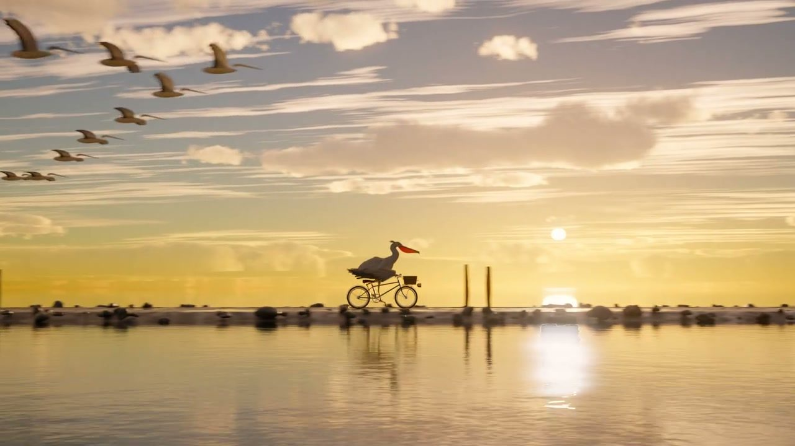</a> | **[A pelican riding a bicycle, made properly](#pelican-riding-a-bicycle)**<br><sub>Showreels and kinetic type</sub> | [SugarV](https://www.xiaohongshu.com/explore/6af44c8b000000001f014c7a) | 401 |  | 9/10 |
| <a href="#makermap-one-shape"></a> | **[MakerMap: one shape morphing through the whole product](#makermap-one-shape)**<br><sub>Product launch films</sub> | [Martijn Verbove](https://x.com/verbove) | 243 | 18.3K | 9/10 |
| <a href="#history-of-ai">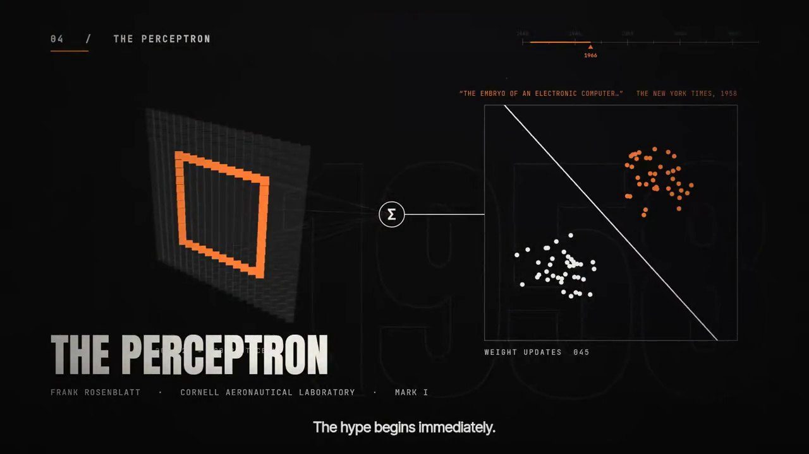</a> | **[83 years of AI in under three minutes](#history-of-ai)**<br><sub>Explainers</sub> | [klöss](https://x.com/kloss_xyz) | 197 | 10.7K | 9/10 |
| <a href="#how-llms-work-fable">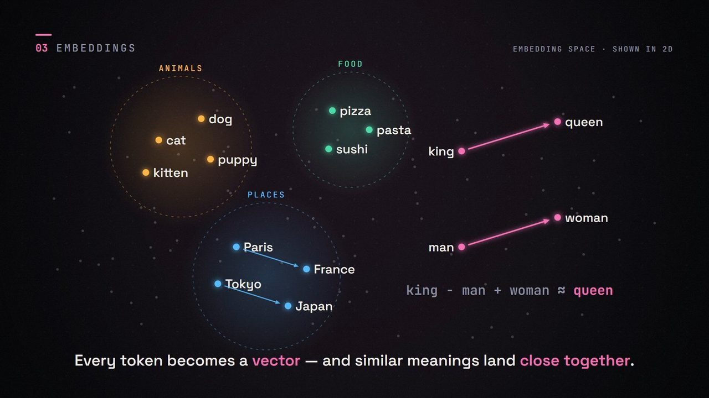</a> | **[How LLMs work, as a motion graphic (Fable 5.2)](#how-llms-work-fable)**<br><sub>Explainers</sub> | [Matthew Berman](https://x.com/MatthewBerman) | 100 | 7.9K | 9/10 |
| <a href="#distilbook-oppenheimer">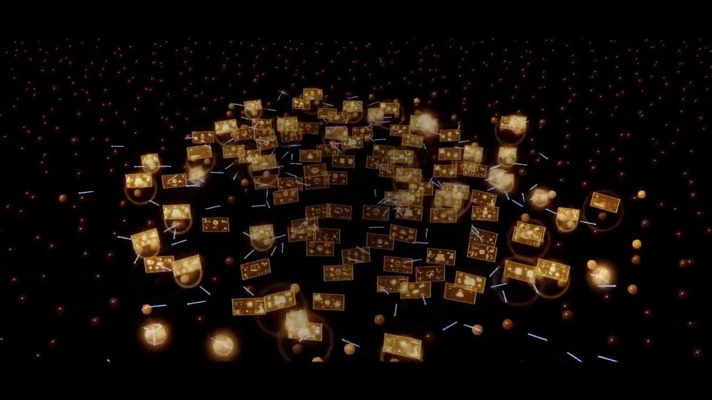</a> | **[Distilbook, scored like Oppenheimer](#distilbook-oppenheimer)**<br><sub>Product launch films</sub> | [Ajith](https://x.com/ajith_io) | 62 | 5.1K | 9/10 |
| <a href="#distilbook-film-strips">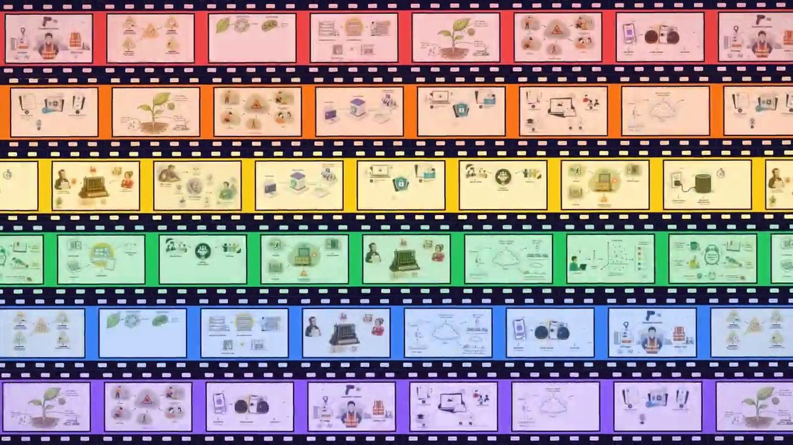</a> | **[Distilbook: film strips spiralling into a tunnel](#distilbook-film-strips)**<br><sub>Product launch films</sub> | [Ajith](https://x.com/ajith_io) | 61 | 14.1K | 9/10 |
| <a href="#psychedelic-showreel">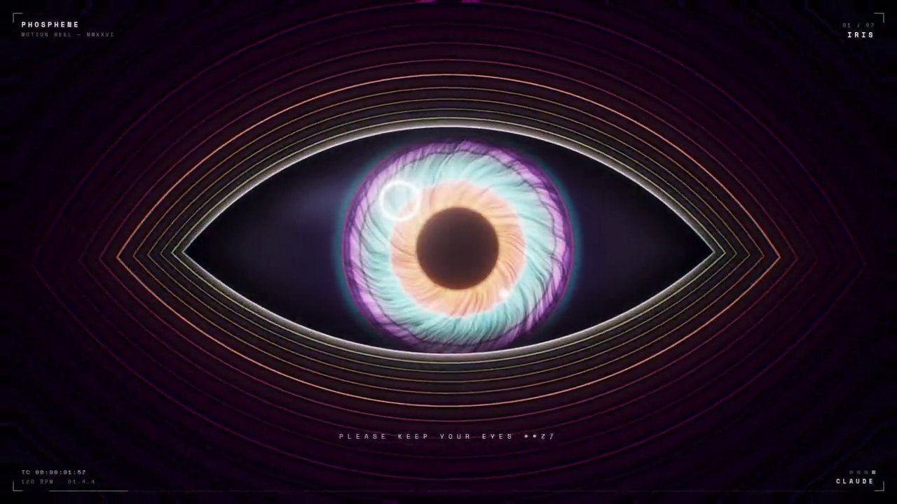</a> | **[Phosphene: a psychedelic motion study](#psychedelic-showreel)**<br><sub>Showreels and kinetic type</sub> | [monokern](https://x.com/monokern) | 57 | 4K | 9/10 |
| <a href="#opus-1984-ad">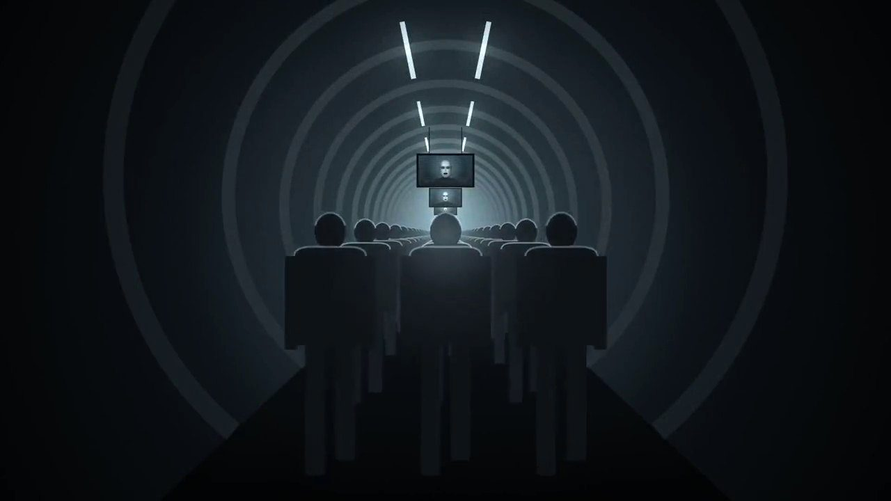</a> | **[An ad for Opus 5.5, after Apple's 1984](#opus-1984-ad)**<br><sub>Logo reveals and brand films</sub> | [1LittleCoder](https://x.com/1littlecoder) | 56 | 3.5K | 9/10 |
| <a href="#poster-breaks-out">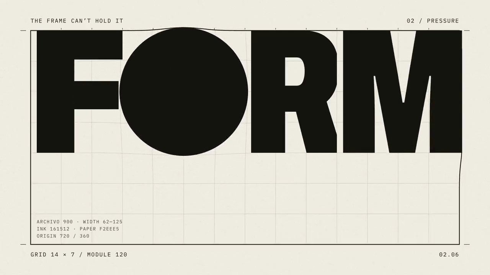</a> | **[A poster breaking out of its own frame](#poster-breaks-out)**<br><sub>Showreels and kinetic type</sub> | [Pankaj Kumar](https://x.com/pankajkumar_dev) | 39 | 4.5K | 9/10 |
| <a href="#i-can">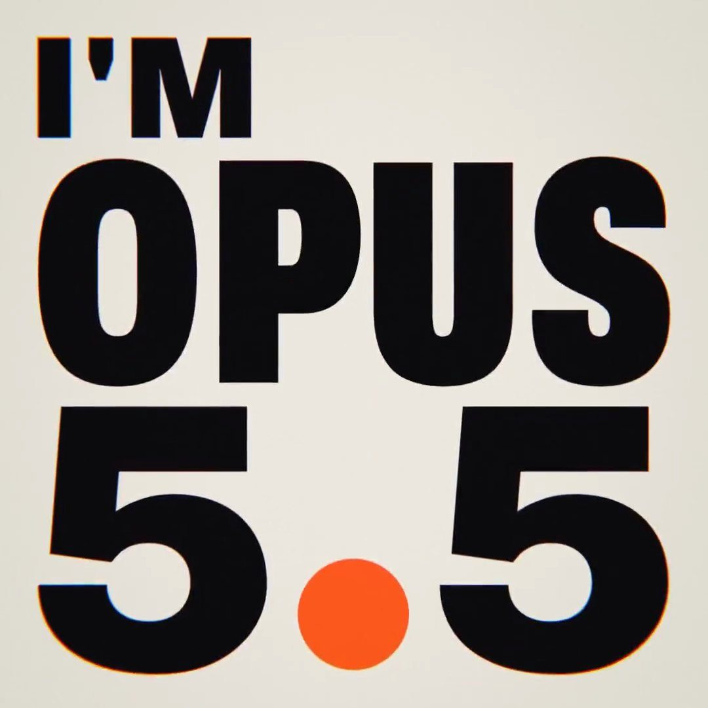</a> | **[I CAN: blur, loop, render, swarm, bend light](#i-can)**<br><sub>Showreels and kinetic type</sub> | [Eugene C](https://x.com/zheke) | 22 | 7.6K | 9/10 |
| <a href="#light-speed-earth">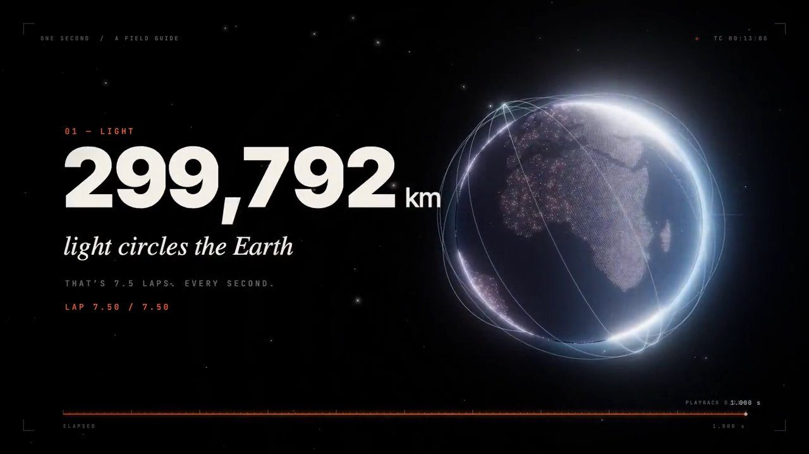</a> | **[One second on Earth](#light-speed-earth)**<br><sub>Showreels and kinetic type</sub> | [Nolan Keegan](https://x.com/nolkeeg) | 1 | 368 | 9/10 |
| <a href="#claude-motion-reel">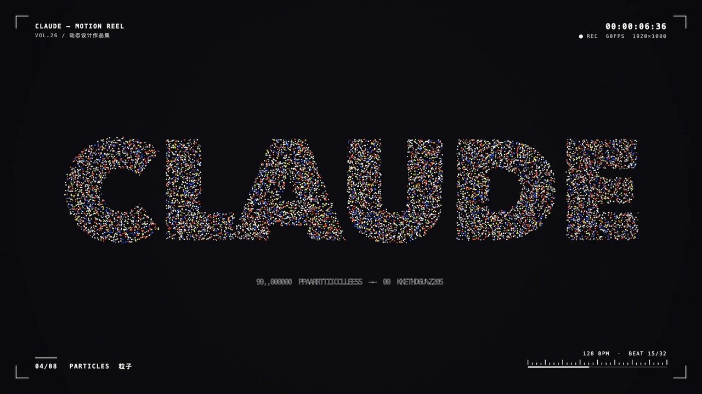</a> | **[Claude, motion designer: a 15-second reel from one sentence](#claude-motion-reel)**<br><sub>Showreels and kinetic type</sub> | [新旧](https://www.xiaohongshu.com/explore/6ac7a32f000000001a02693d) | 2.3K |  | 8/10 |
| <a href="#no-samples-showreel">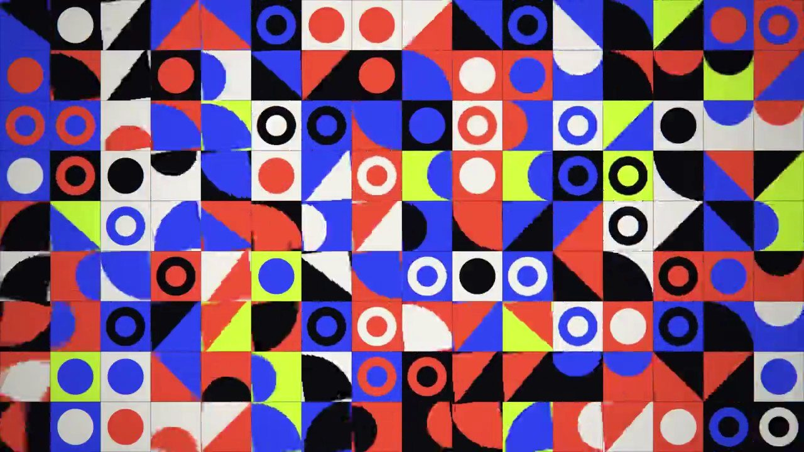</a> | **[A showreel with music synthesized from scratch](#no-samples-showreel)**<br><sub>Showreels and kinetic type</sub> | [Prasenjit](https://x.com/prasenx) | 206 | 15.1K | 8/10 |
| <a href="#motionsites-1m-visitors"></a> | **[MotionSites hits 1 million monthly visitors](#motionsites-1m-visitors)**<br><sub>Product launch films</sub> | [Viktor Oddy](https://x.com/viktoroddy) | 110 | 11.2K | 8/10 |
| <a href="#famewall-mascot">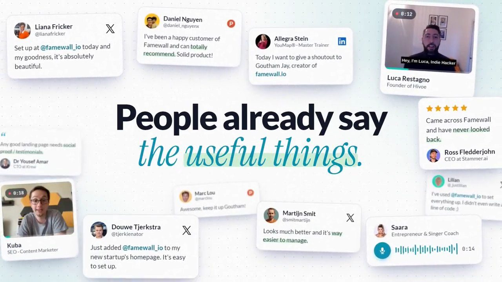</a> | **[Famewall: it found the mascot and brought it in](#famewall-mascot)**<br><sub>Product launch films</sub> | [Goutham Jay](https://x.com/gouthamjay8) | 86 | 7K | 8/10 |
| <a href="#lumail-pricing">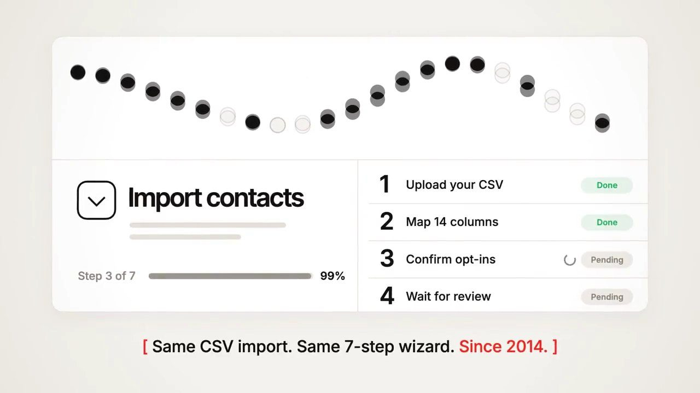</a> | **[Lumail: email marketing your AI agent can run](#lumail-pricing)**<br><sub>Product launch films</sub> | [Melvyn](https://x.com/melvynx) | 86 | 29.8K | 8/10 |
| <a href="#easing-explained">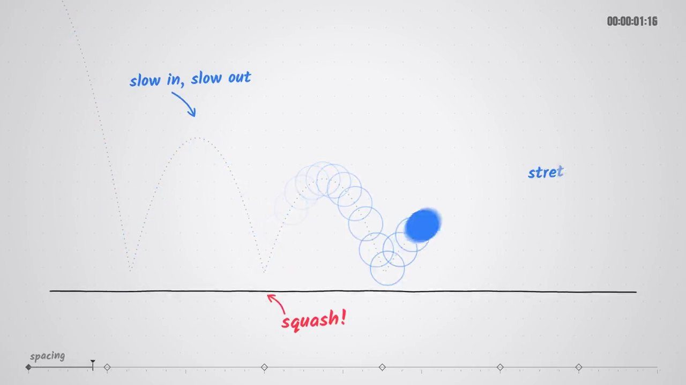</a> | **[I make things move: Motion Designer Claude](#easing-explained)**<br><sub>Showreels and kinetic type</sub> | [摸鱼巨匠](https://x.com/ChatGptAstra) | 63 | 10.1K | 8/10 |
| <a href="#paybox-brand-sting"></a> | **[PayBox: a brand sting from a logo](#paybox-brand-sting)**<br><sub>Logo reveals and brand films</sub> | [Valure](https://x.com/0xValure) | 35 | 6.9K | 8/10 |
| <a href="#founder-page-launch"></a> | **[founder.page: every feature in 20 seconds](#founder-page-launch)**<br><sub>Product launch films</sub> | [Jaisal](https://x.com/RatheeJaisal) | 29 | 3.2K | 8/10 |
| <a href="#tanstack-ai-launch"></a> | **[TanStack AI: a developer-tool launch film](#tanstack-ai-launch)**<br><sub>Product launch films</sub> | [Shivay Lamba](https://x.com/HowDevelop) | 25 | 4.4K | 8/10 |
| <a href="#sahi-trading-terminal">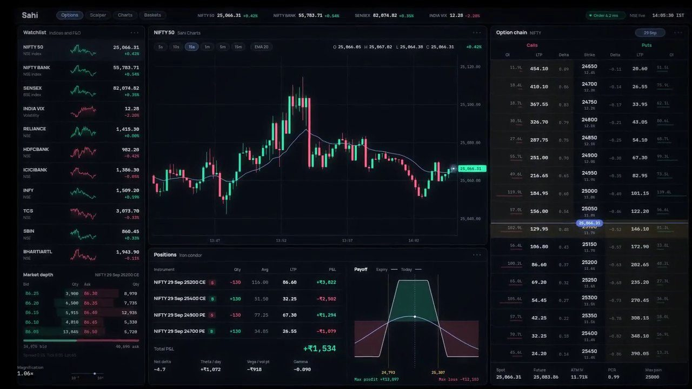</a> | **[A trading terminal that zooms out to a point in space](#sahi-trading-terminal)**<br><sub>Product launch films</sub> | [Dale Vaz](https://x.com/dale_vaz) | 23 | 2.8K | 8/10 |
| <a href="#white-russian-recipe">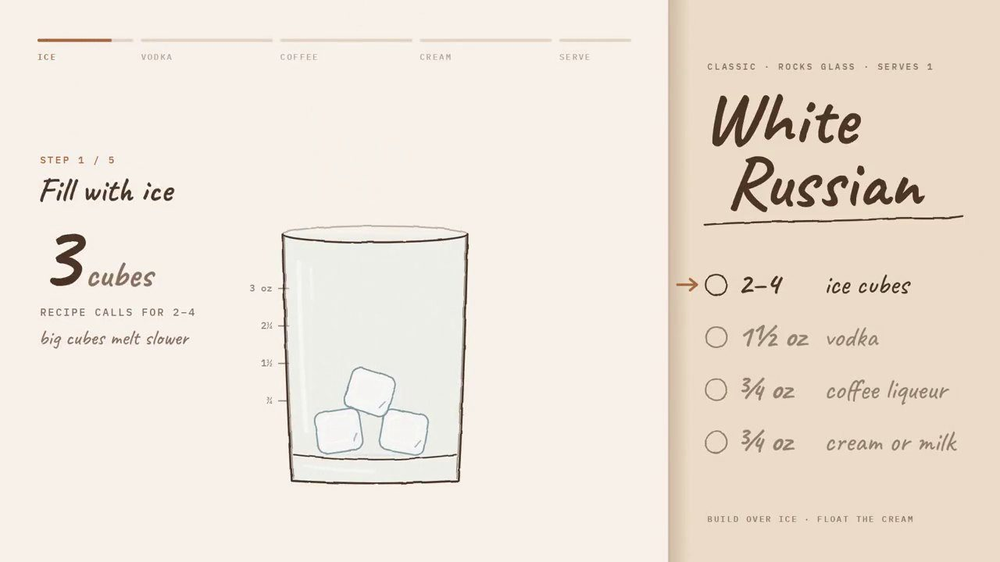</a> | **[A White Russian, poured in hand-drawn style](#white-russian-recipe)**<br><sub>Explainers</sub> | [Sarutobi Sasuke](https://x.com/Sarut0biSasuke) | 22 | 1.3K | 8/10 |
| <a href="#aisa-one-key">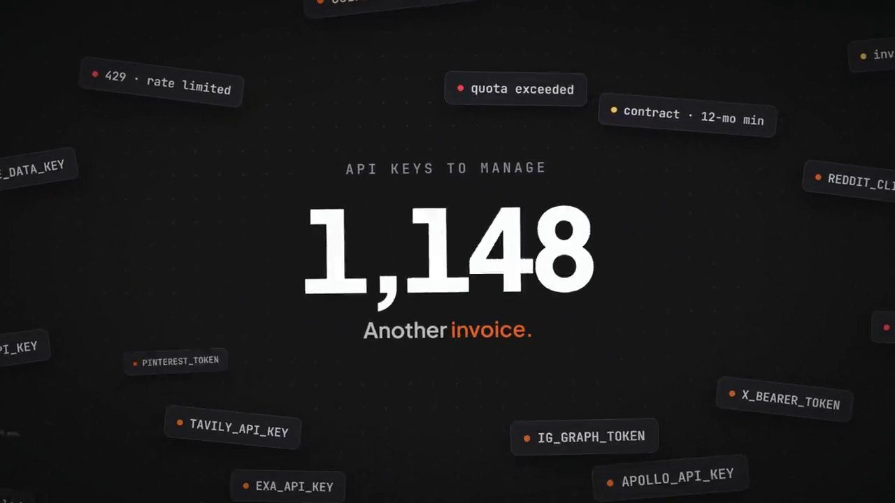</a> | **[AIsa: 5,000 API keys become one](#aisa-one-key)**<br><sub>Product launch films</sub> | [Rafael](https://x.com/0xfemyn) | 9 | 669 | 8/10 |
| <a href="#flowdrive-showreel">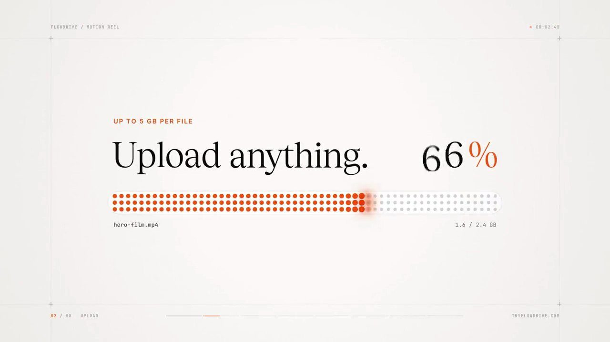</a> | **[Flowdrive: stream in 4K, delivered everywhere](#flowdrive-showreel)**<br><sub>Product launch films</sub> | [Manuel Ogomigo](https://x.com/manuelogomigo) | 6 | 1.7K | 8/10 |
| <a href="#matra-apple-style">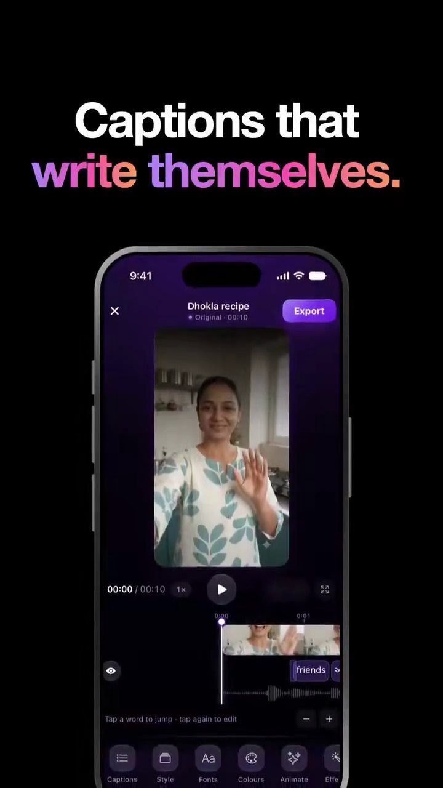</a> | **[Matra: an Apple-style film for an app](#matra-apple-style)**<br><sub>Product launch films</sub> | [Gautam](https://x.com/gautam_mer1) | 4 | 255 | 8/10 |
| <a href="#portfolio-film"></a> | **[A designer's portfolio, turned into a film](#portfolio-film)**<br><sub>Showreels and kinetic type</sub> | [Mallik Cheripally](https://x.com/heyiammallik) | 4 | 343 | 8/10 |
| <a href="#no-hands-labs">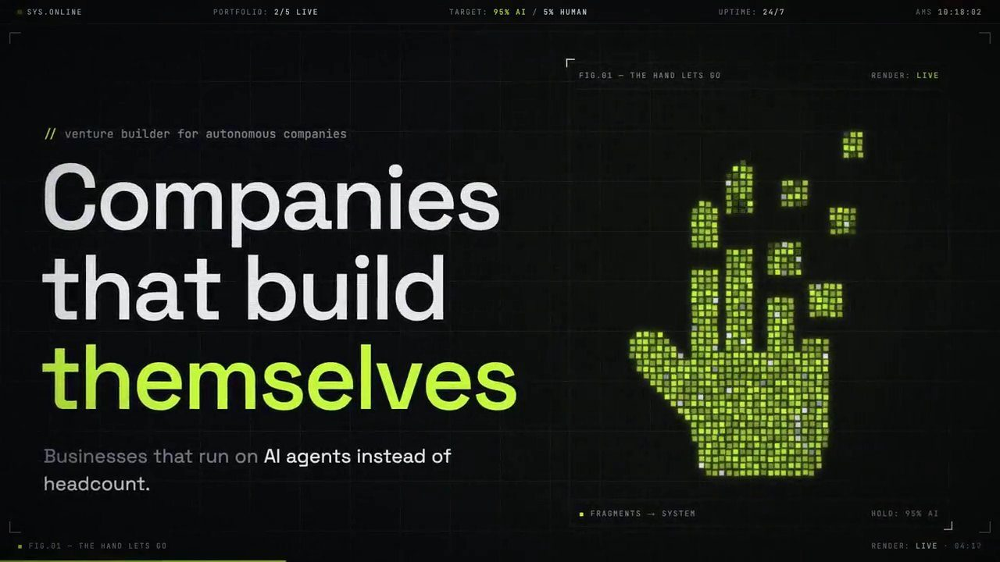</a> | **[No Hands Labs: companies that build themselves](#no-hands-labs)**<br><sub>Product launch films</sub> | [iamrobinvv](https://x.com/robvjourney) | 2 | 247 | 8/10 |
| <a href="#paymentform-logo-reveal">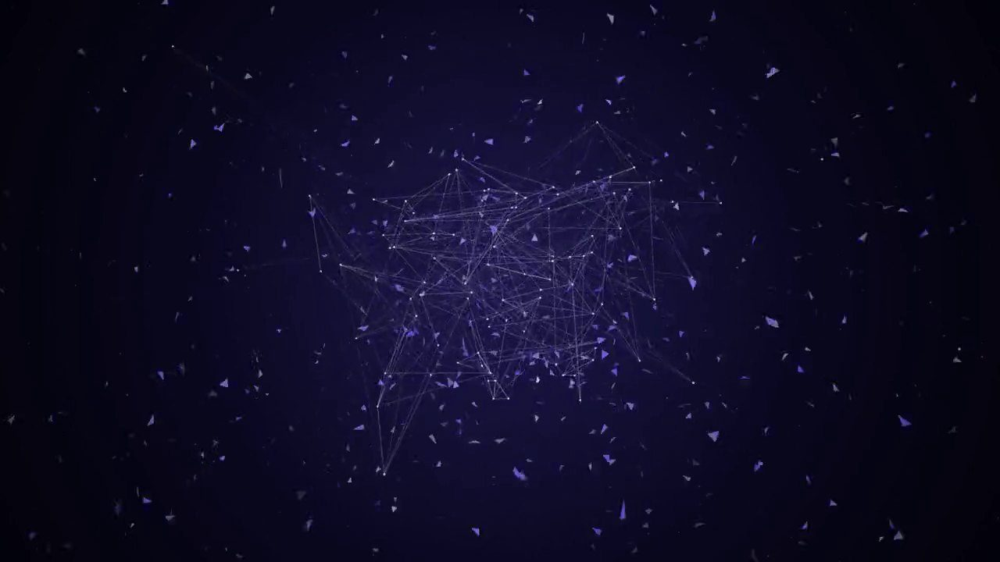</a> | **[PaymentForm: a logo built from low-poly shards](#paymentform-logo-reveal)**<br><sub>Logo reveals and brand films</sub> | [Abdul kaioum](https://x.com/Mounnna) | 2 | 213 | 8/10 |
| <a href="#it-thinks-in-curves">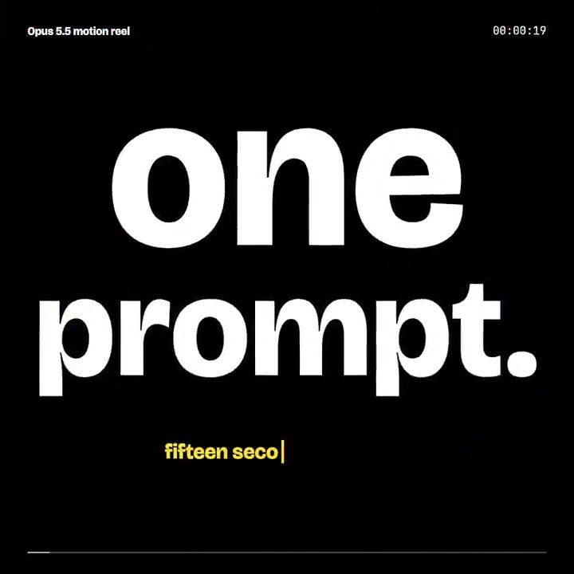</a> | **[Rhythm, type, loops: it thinks in curves](#it-thinks-in-curves)**<br><sub>Showreels and kinetic type</sub> | [Ishaaq Ahamed](https://x.com/Ishaaqahamed) | 2 | 529 | 8/10 |
| <a href="#opus-retro-launch"></a> | **[A retro-futuristic Opus 5.5 launch film](#opus-retro-launch)**<br><sub>Logo reveals and brand films</sub> | [John Savage](https://x.com/johnsavage_ai) | 1 | 551 | 8/10 |
| <a href="#who-are-you-opus">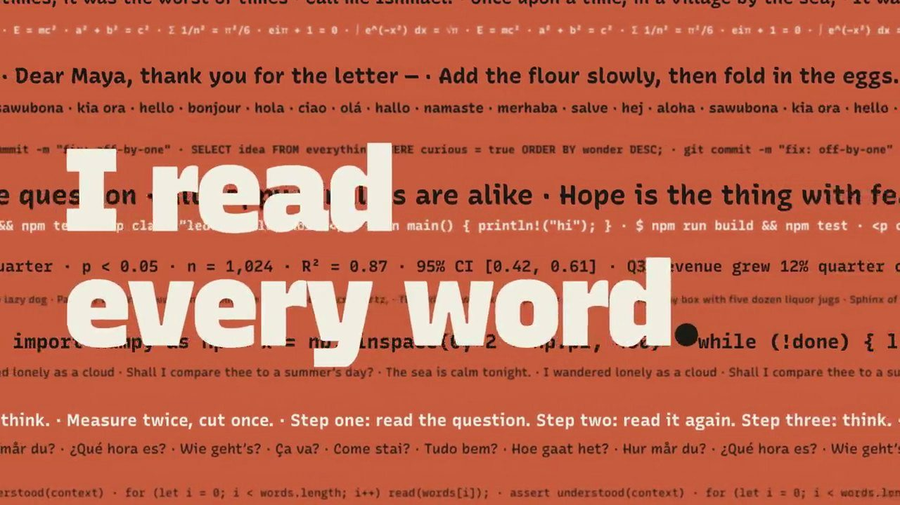</a> | **[Hi, I'm Claude: Opus 5.5 introduces itself](#who-are-you-opus)**<br><sub>Showreels and kinetic type</sub> | [Sourav Bhar](https://x.com/souravbhar871) |  | 120 | 8/10 |
| <a href="#pen-designs-launch">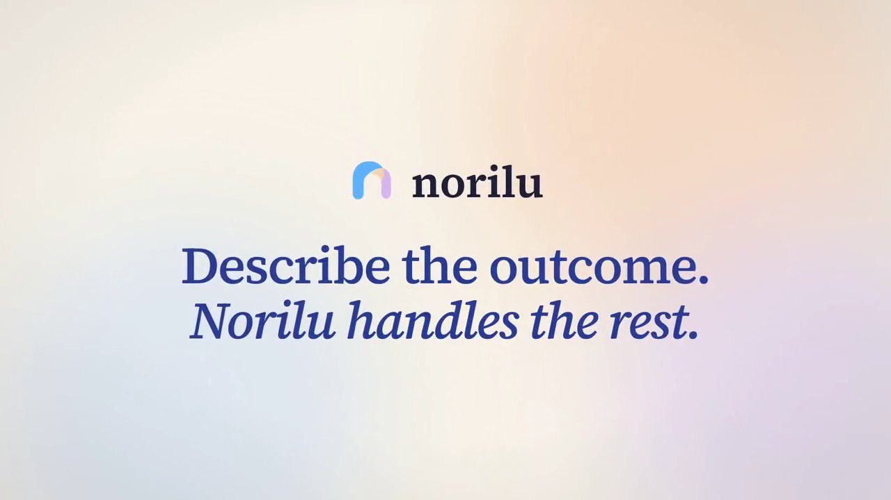</a> | **[norilu: hand off the work that keeps coming back](#pen-designs-launch)**<br><sub>Product launch films</sub> | [Sacha Arbonel](https://x.com/sachaarbonel) | 12 | 2.4K | 7/10 |
| <a href="#bento-surf"></a> | **[Bento.surf: a 40-second product film](#bento-surf)**<br><sub>Product launch films</sub> | [Yash Gawde](https://x.com/bizibeast) | 7 | 689 | 7/10 |
| <a href="#madhav-about-me">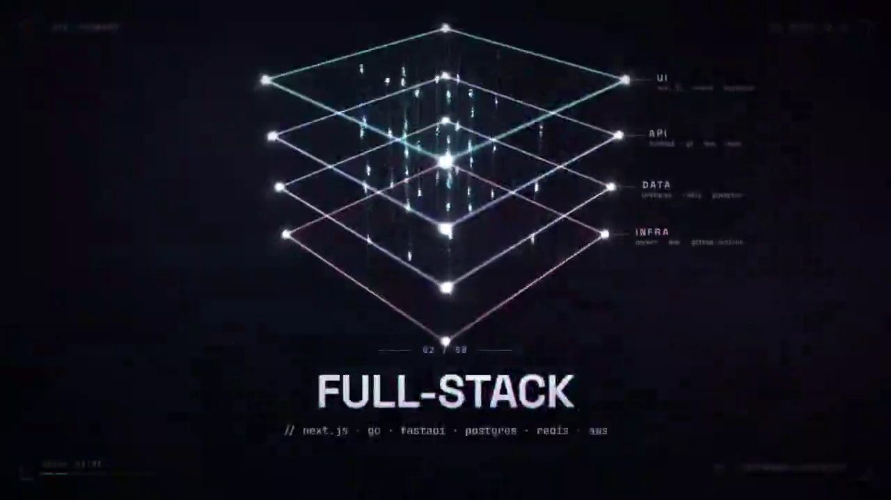</a> | **[A 10-second film about the person asking](#madhav-about-me)**<br><sub>Showreels and kinetic type</sub> | [Madhav](https://x.com/Madhav_XO) | 7 | 241 | 7/10 |
| <a href="#quickemailverify"></a> | **[QuickEmailVerify: stop bounces before you hit send](#quickemailverify)**<br><sub>Product launch films</sub> | [Khondokar MD Asiful Islam](https://x.com/KmAsiff) | 3 | 180 | 7/10 |
| <a href="#orbe-everyday-spending"></a> | **[Orbe: everyday spending, in isometric 3D](#orbe-everyday-spending)**<br><sub>Product launch films</sub> | [Felipe Möller](https://x.com/felipemoller) | 1 | 246 | 7/10 |
| <a href="#winkz-pitch"></a> | **[A pitch film for an Amazon wholesale business](#winkz-pitch)**<br><sub>Product launch films</sub> | [Tyler](https://x.com/ceowinkz) |  | 239 | 7/10 |
| <a href="#queryglow-launch">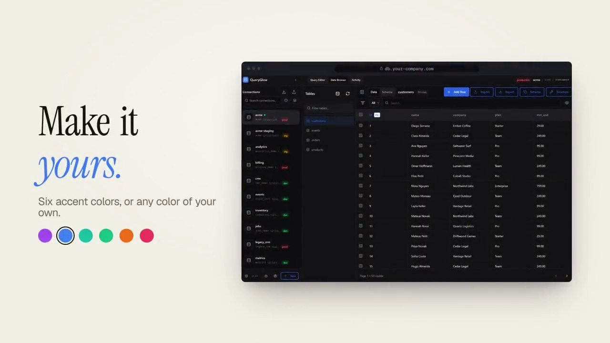</a> | **[QueryGlow: a launch film in Anthropic's style](#queryglow-launch)**<br><sub>Product launch films</sub> | [Max](https://x.com/iamMXFSCHR) |  | 94 | 7/10 |

## Product launch films

### Muda: a launch film for an inference startup, in one minute for about $2
<a id="inference-startup-launch"></a>

<p><a href="https://x.com/deedydas/status/2102787937482252537"></a> <a href="https://x.com/deedydas/status/2102787937482252537">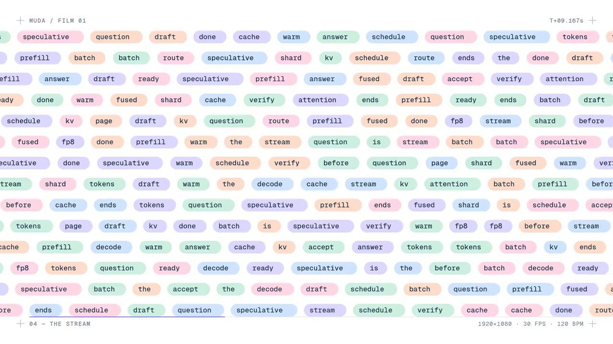</a> <a href="https://x.com/deedydas/status/2102787937482252537">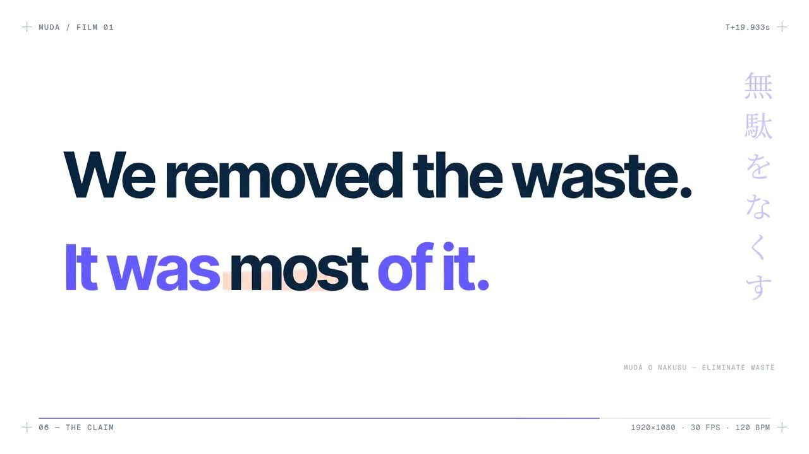</a></p>

"Most of inference is waiting. Not anymore." Grids of requests light up as throughput climbs, then the brand lands: a slick, punchy launch film for a made-up inference startup called muda that "removed the waste". No video model and no extra libraries: Claude wrote the animation as a web page, then recorded it with Playwright and ffmpeg.

- **Watch:** [the original post on X](https://x.com/deedydas/status/2102787937482252537) (3.3K likes, 353.9K views), posted 2026-09-23
- **Made by:** Deedy ([@deedydas](https://x.com/deedydas)) with Claude Opus 5.5

**Prompt** (verbatim, in the post):

```text
make a modern slick and punchy video for a modern startup that works on inference
```

<sub>Our score: 10/10 for design, polish and motion.</sub>

### TypingMind: one prompt instead of four weeks with freelancers
<a id="typingmind-launch"></a>

<p><a href="https://x.com/ann_nnng/status/2103723183899852885"></a> <a href="https://x.com/ann_nnng/status/2103723183899852885">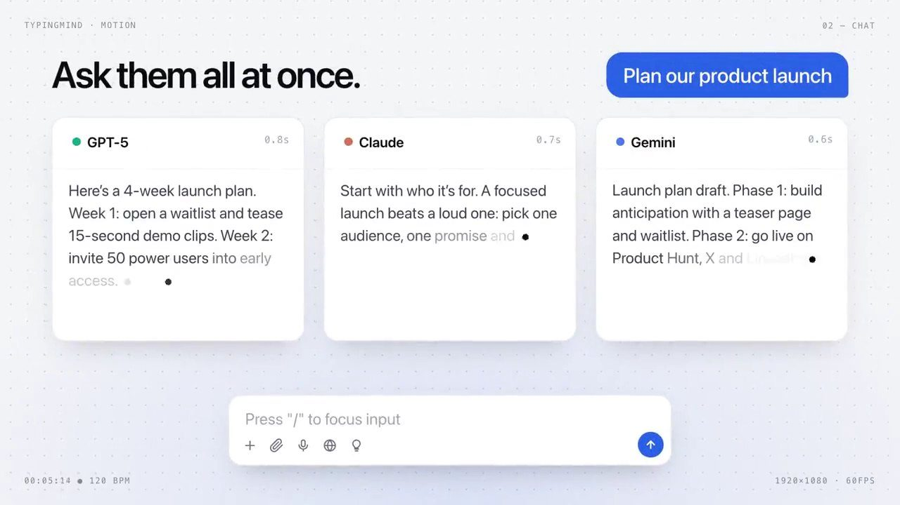</a> <a href="https://x.com/ann_nnng/status/2103723183899852885"></a></p>

Opus visited the product's pages, wrote the script and animated it: one chat box asking several models at once, then cards for every team. The maker used to spend nearly four weeks with two freelancers on videos like this; this took one prompt and almost an hour in Claude Code, with no skills installed.

- **Watch:** [the original post on X](https://x.com/ann_nnng/status/2103723183899852885) (984 likes, 102.8K views), posted 2026-09-26
- **Made by:** Ann Nguyen ([@ann_nnng](https://x.com/ann_nnng)) with Claude Opus 5.5

**Prompt** (verbatim, in the maker's reply to the post):

```text
Make a dynamic 15-second motion graphics video that shows what an incredible motion designer you are. The content should focus on [your product]. You should visit the pages first to learn about the product, then write the video content yourself.
```

<sub>Our score: 9/10 for design, polish and motion.</sub>

### A Notion launch film, product picked by Opus
<a id="notion-launch-it-picked"></a>

<p><a href="https://x.com/moritzkremb/status/2103066071838466494"></a> <a href="https://x.com/moritzkremb/status/2103066071838466494"></a> <a href="https://x.com/moritzkremb/status/2103066071838466494">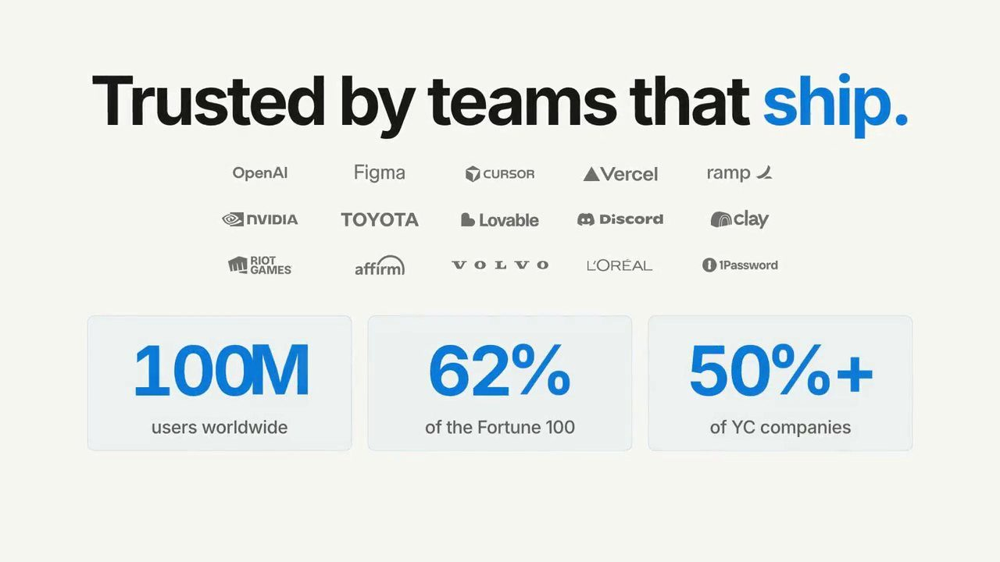</a></p>

Told only to pick a SaaS people know and make a professional launch video, Opus chose Notion, pulled real assets from the web and cut a polished feature film: docs and chats in one place, answers with citations, agents working 24/7.

- **Watch:** [the original post on X](https://x.com/moritzkremb/status/2103066071838466494) (444 likes, 100.3K views), posted 2026-09-24
- **Made by:** [@moritzkremb](https://x.com/moritzkremb) with Claude Opus 5.5

**Prompt** (verbatim, in the maker's reply to the post):

```text
I want you to create a highly professional SaaS product launch video. Go and find some SaaS, preferably just one that people know, so it's easier to identify with it. Pick that, and then make sure to get actual assets and images and all of that stuff from the internet. Turn it into these typical, very professionally edited, motion-graphics-styled product launch videos that you see people making on Twitter when they launch new SaaS products (which are showing off the features, the benefits, and all of these things).
```

<sub>Our score: 9/10 for design, polish and motion.</sub>

### MakerMap: one shape morphing through the whole product
<a id="makermap-one-shape"></a>

<p><a href="https://x.com/verbove/status/2103483957266268381"></a> <a href="https://x.com/verbove/status/2103483957266268381">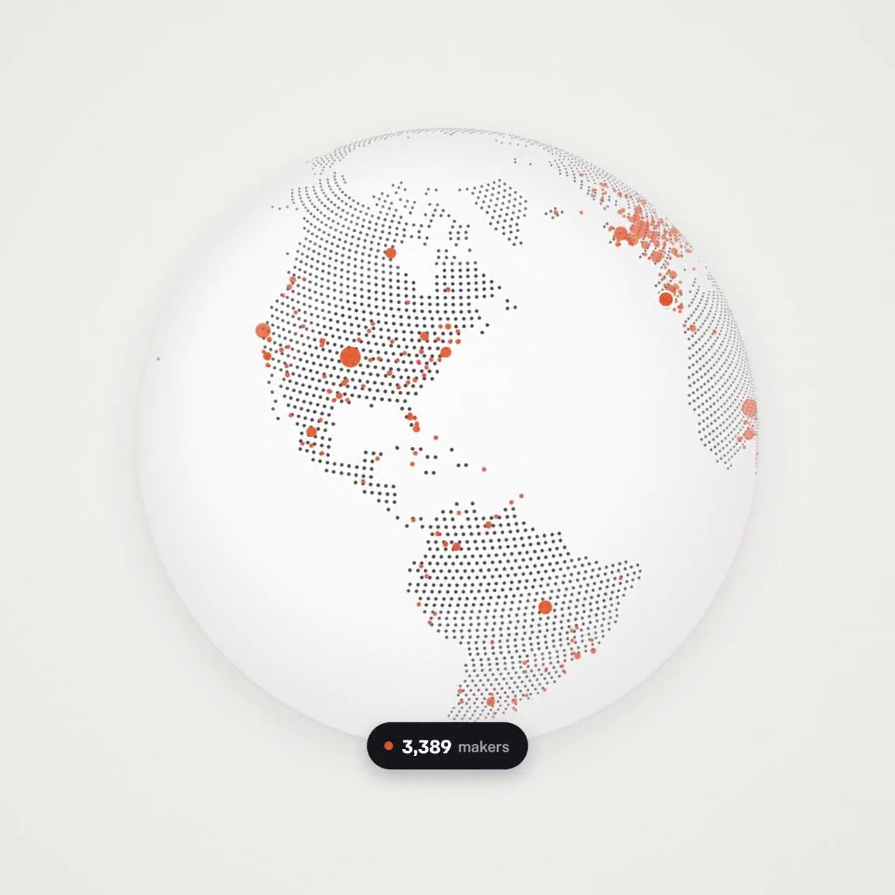</a> <a href="https://x.com/verbove/status/2103483957266268381">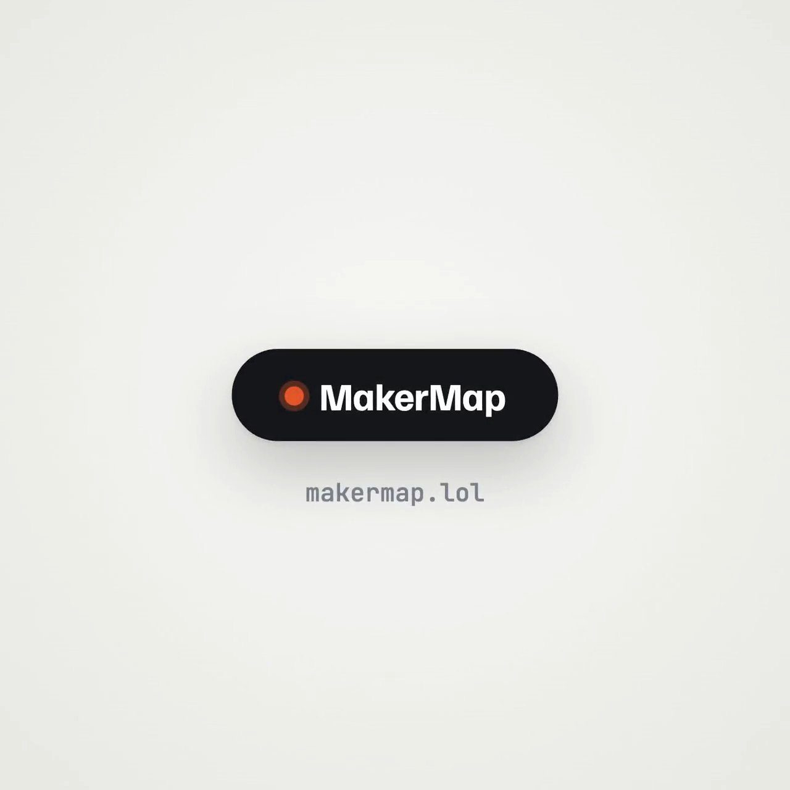</a></p>

Twenty seconds of a single shape morphing through sign-up, your pin, 3,393 real makers lighting up a globe, matches, a meetup and search. The springs, cursor, morphs and motion blur are deterministic math in one HTML file.

- **Watch:** [the original post on X](https://x.com/verbove/status/2103483957266268381) (243 likes, 18.3K views), posted 2026-09-25
- **Made by:** Martijn Verbove ([@verbove](https://x.com/verbove)) with Claude Opus 5.5

<details><summary><b>Prompt</b> (verbatim, in the post, click to expand)</summary>

```text
<inputs>
Ask me for:
• my product + URL
• 8–12 UI states that tell its story
• the real data shown in each state
• brand colors + fonts + accent color
• required formats (1:1, 16:9, 9:16)
</inputs>

<rules>
One HTML file. One canvas
One draw(t) function

No CSS transitions
No timers
No state carried between frames

One shape, never cut

Every state is the same element changing size, radius and color while the content swaps

A cursor drives the sequence with real clicks, typing and one drag

Real UI. Real data. No placeholders.

</rules>
<structure>
120 BPM grid

Something happens on every bea

logo → button → handle field → “is this you?” → loader → pin → globe filling with users → matches → tabs → RSVP → search → logo

</structure>

<motion>
Closed-form springs everywhere with only a tiny overshoot.

If a value changes target multiple times, sum one spring per change

Content enters after its container starts morphing and leaves before the next morph so text never overlaps

Use a short blur on transitions

Never fade black directly into the accent color. Move an accent element between states instead

Make tab indicators stretch by putting each edge on a different spring

Zoom the camera so every state fills the frame

Make the last frame equal the first so the whole thing loops
</motion>

<export>
First render one frame per beat as a contact sheet

Fix anything cramped or broken

Then render every frame in headless Chrome at 60fps, averaging 6 subframes for motion blur

Pipe into ffmpeg:
H.264 + yuv420p

Export all aspect ratios in parallel
</export>
```

</details>

<sub>Our score: 9/10 for design, polish and motion.</sub>

### Distilbook, scored like Oppenheimer
<a id="distilbook-oppenheimer"></a>

<p><a href="https://x.com/ajith_io/status/2103800569584562538"></a> <a href="https://x.com/ajith_io/status/2103800569584562538">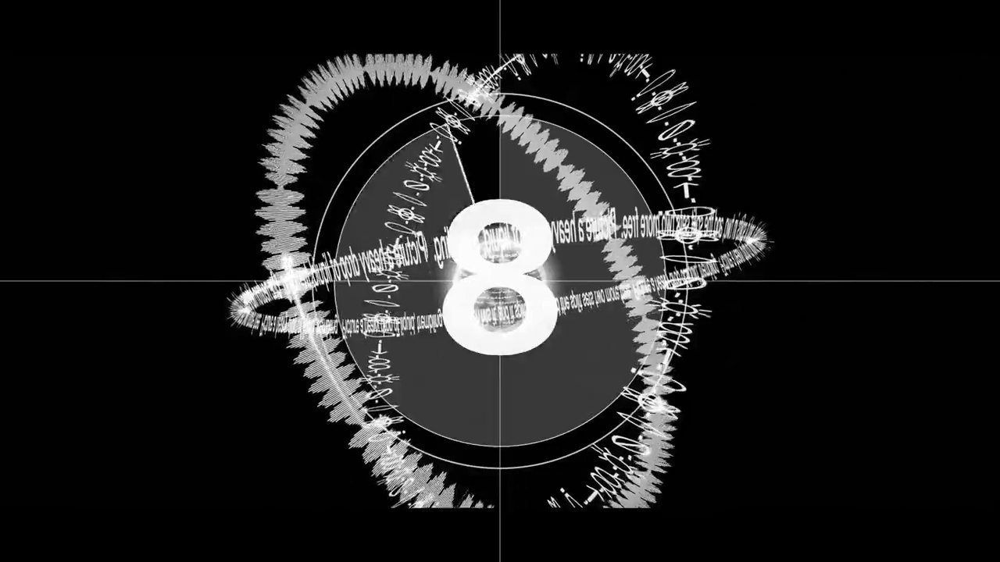</a> <a href="https://x.com/ajith_io/status/2103800569584562538">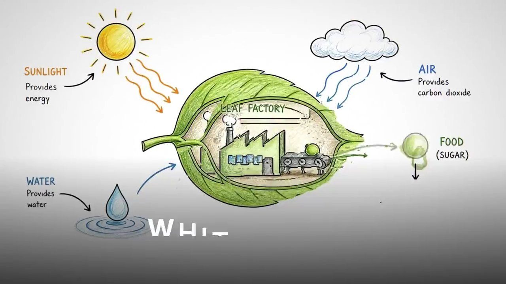</a></p>

In two chapters, Fission and Fusion: a lamp-lit page, thousands of golden pages swarming into headlines like "Any PDF", a countdown and an explosion, to music Opus composed itself after the Oppenheimer theme.

- **Watch:** [the original post on X](https://x.com/ajith_io/status/2103800569584562538) (62 likes, 5.1K views), posted 2026-09-26
- **Made by:** Ajith ([@ajith_io](https://x.com/ajith_io)) with Claude Opus 5.5

**Prompt** (verbatim, in the post):

```text
Make a dynamic 40-second motion graphics video on Distilbook that shows what an incredible motion designer you are, like it's your showreel - go all out. Use the Oppenheimer theme music as inspiration, but compose it yourself.
```

<sub>Our score: 9/10 for design, polish and motion.</sub>

### Distilbook: film strips spiralling into a tunnel
<a id="distilbook-film-strips"></a>

<p><a href="https://x.com/ajith_io/status/2103541149709615243"></a> <a href="https://x.com/ajith_io/status/2103541149709615243">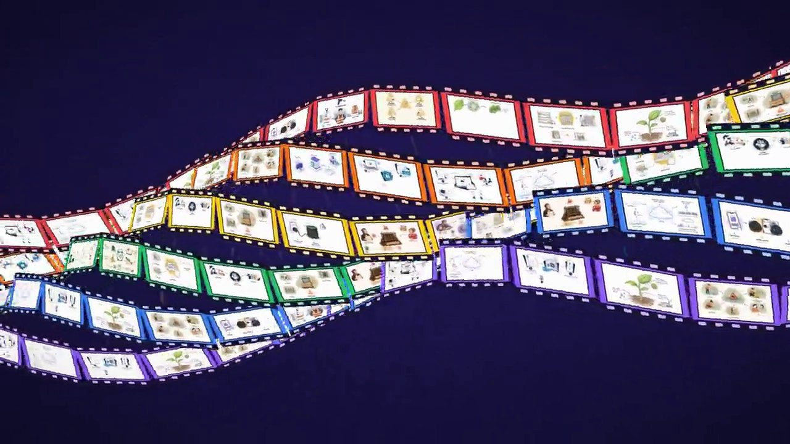</a> <a href="https://x.com/ajith_io/status/2103541149709615243">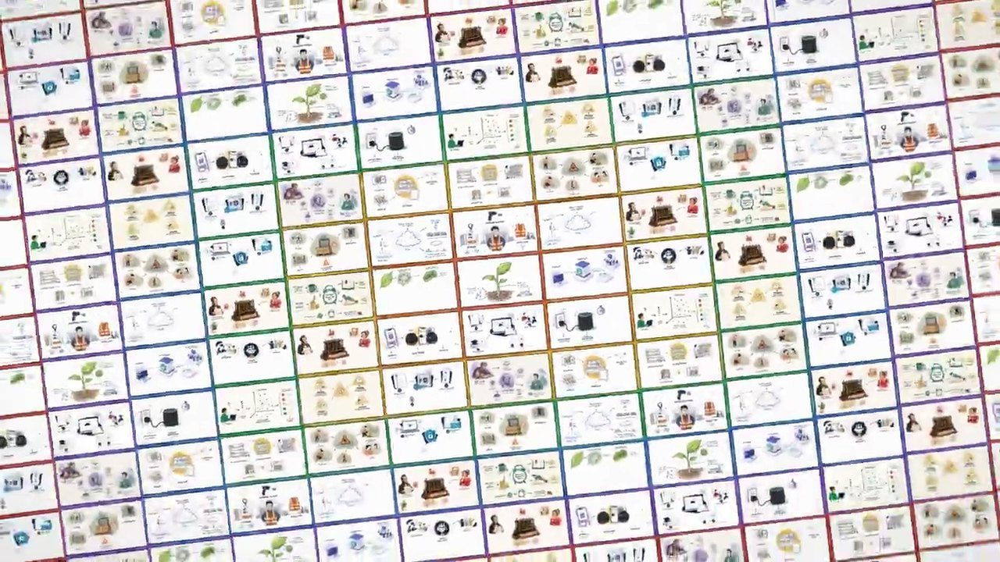</a></p>

A rainbow of film strips sweeps across the screen and coils into a glowing tunnel, styled after a reference video the maker gave it. Made entirely with code; the final version has no manual edits.

- **Watch:** [the original post on X](https://x.com/ajith_io/status/2103541149709615243) (61 likes, 14.1K views), posted 2026-09-25
- **Made by:** Ajith ([@ajith_io](https://x.com/ajith_io)) with Claude Opus 5.5

**Prompt** (verbatim, in the post):

```text
Take reference from the given video (download it) and use the same visual style.
and Research about Distilbook. Make a dynamic 30-second motion graphics video on Distilbook that shows what an incredible motion designer you are. like it's your showreel - Go all out.
One thing to keep in mind: it should be cool as fck.
```

<sub>Our score: 9/10 for design, polish and motion.</sub>

### MotionSites hits 1 million monthly visitors
<a id="motionsites-1m-visitors"></a>

<p><a href="https://x.com/viktoroddy/status/2103802280617402509"></a> <a href="https://x.com/viktoroddy/status/2103802280617402509">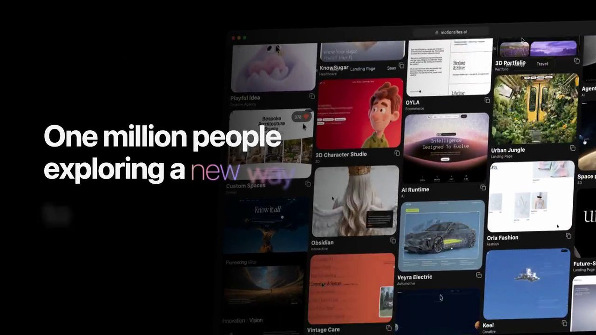</a> <a href="https://x.com/viktoroddy/status/2103802280617402509">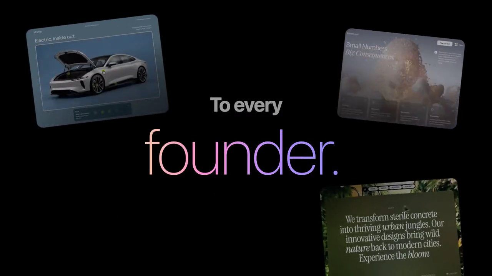</a></p>

A milestone film with a rolling counter racing up to a million visitors. One shot in four minutes, with one change.

- **Watch:** [the original post on X](https://x.com/viktoroddy/status/2103802280617402509) (110 likes, 11.2K views), posted 2026-09-26
- **Made by:** [@viktoroddy](https://x.com/viktoroddy) with Claude Opus 5.5

**Prompt** (verbatim, in the post):

```text
Create a launch video for MotionSites AI, just hit 1 million monthly visitors after 8 months after launch.
```

<sub>Our score: 8/10 for design, polish and motion.</sub>

### Famewall: it found the mascot and brought it in
<a id="famewall-mascot"></a>

<p><a href="https://x.com/gouthamjay8/status/2103816261339910269"></a> <a href="https://x.com/gouthamjay8/status/2103816261339910269"></a> <a href="https://x.com/gouthamjay8/status/2103816261339910269"></a></p>

A launch film for a testimonials product. Opus dug into the site's SVGs, found its mascot and worked it into the video without being asked.

- **Watch:** [the original post on X](https://x.com/gouthamjay8/status/2103816261339910269) (86 likes, 7K views), posted 2026-09-26
- **Made by:** Goutham Jay ([@gouthamjay8](https://x.com/gouthamjay8)) with Claude Opus 5.5

**Prompt** (verbatim, in the maker's reply to the post):

```text
I want you to create a highly professional SaaS product launch video. Go and look up [website] Pick that, and then make sure to get actual assets and images and all of that stuff from the internet. Turn it into these typical, very professionally edited, motion-graphics-styled product launch videos that you see people making on Twitter when they launch new SaaS products (which are showing off the features, the benefits, and all of these things). It should show what an incredible motion designer you are, like it's your showreel for a resume. Go all out.
```

<sub>Our score: 8/10 for design, polish and motion.</sub>

### Lumail: email marketing your AI agent can run
<a id="lumail-pricing"></a>

<p><a href="https://x.com/melvynx/status/2103714680577638493"></a> <a href="https://x.com/melvynx/status/2103714680577638493">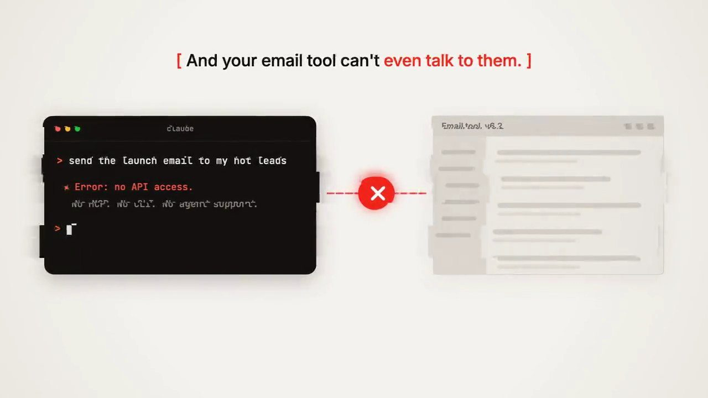</a> <a href="https://x.com/melvynx/status/2103714680577638493"></a></p>

Dot grids of contacts who never open an email and a monthly bill that keeps climbing, then the pitch: email marketing your AI agent can actually run. Made in under ten minutes, with no skill, just the prompt.

- **Watch:** [the original post on X](https://x.com/melvynx/status/2103714680577638493) (86 likes, 29.8K views), posted 2026-09-26
- **Made by:** Melvyn ([@melvynx](https://x.com/melvynx)) with Claude Opus 5.5

**Prompt** (verbatim, in the post):

```text
make a dynamic 15-second motion graphics video that shows what an incredible motion designer you are for <website url>
```

<sub>Our score: 8/10 for design, polish and motion.</sub>

### founder.page: every feature in 20 seconds
<a id="founder-page-launch"></a>

<p><a href="https://x.com/RatheeJaisal/status/2103774864742154698"></a> <a href="https://x.com/RatheeJaisal/status/2103774864742154698">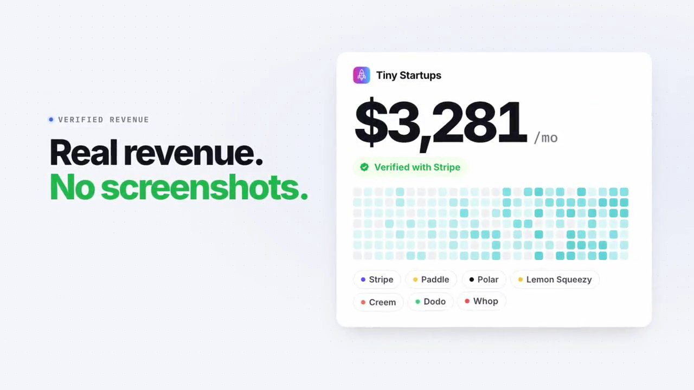</a> <a href="https://x.com/RatheeJaisal/status/2103774864742154698"></a></p>

A fast, on-brand launch film that runs through every feature, with real revenue counters. One shot in Claude Code.

- **Watch:** [the original post on X](https://x.com/RatheeJaisal/status/2103774864742154698) (29 likes, 3.2K views), posted 2026-09-26
- **Made by:** Jaisal ([@RatheeJaisal](https://x.com/RatheeJaisal)) with Claude Opus 5.5

**Prompt** (verbatim, in the post):

```text
build me a beautiful launch video 20 seconds or under that shows all our key features, make it fast paced and fit our brand
```

<sub>Our score: 8/10 for design, polish and motion.</sub>

### TanStack AI: a developer-tool launch film
<a id="tanstack-ai-launch"></a>

<p><a href="https://x.com/HowDevelop/status/2103840883812733090"></a> <a href="https://x.com/HowDevelop/status/2103840883812733090">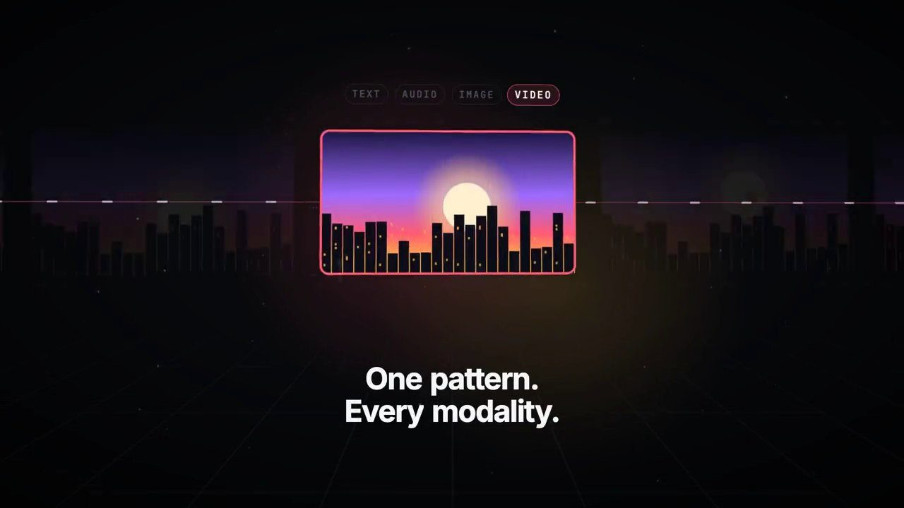</a> <a href="https://x.com/HowDevelop/status/2103840883812733090">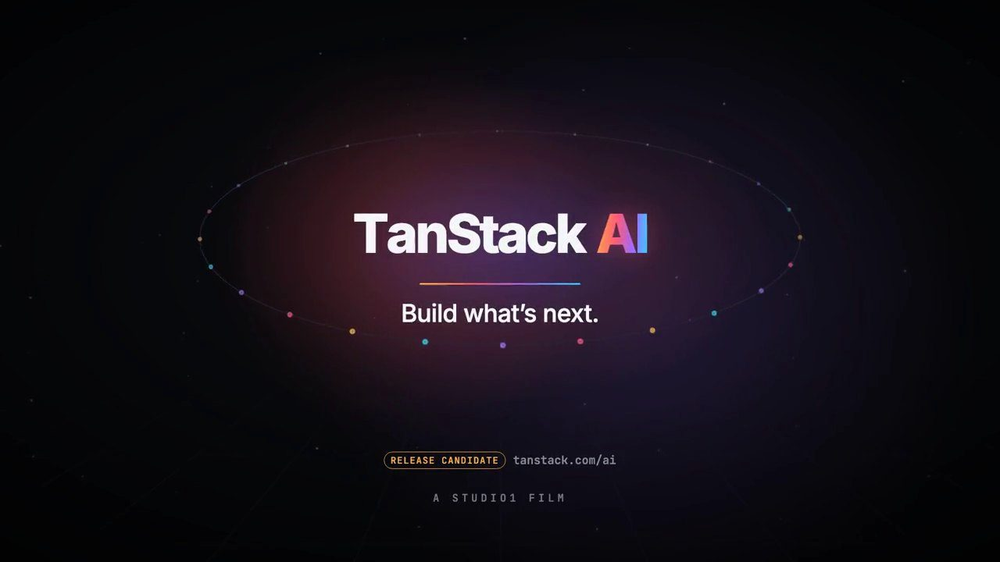</a></p>

A launch-style film for TanStack AI, made with Opus 5.5 and Remotion from a single long brief about a premium developer-tool film fit to open a keynote.

- **Watch:** [the original post on X](https://x.com/HowDevelop/status/2103840883812733090) (25 likes, 4.4K views), posted 2026-09-26
- **Made by:** Shivay Lamba ([@HowDevelop](https://x.com/HowDevelop)) with Claude Opus 5.5

<details><summary><b>Prompt</b> (verbatim, in the maker's reply to the post, click to expand)</summary>

```text
Create and render a 15-second motion graphics video introducing TanStack AI. Make it feel like a premium
  developer-tool launch film produced by Studio1: fast, precise, visually surprising, and polished enough to open a
  keynote or lead a social campaign.

  Use the TanStack AI feature details below as the source of truth. Studio1 is presenting the film; do not imply
  Studio1 built TanStack AI.

  Format and deliverables
  - 1920×1080, 30 fps, exactly 15 seconds; keep important content within a 9:16-safe central area.
  - Deliver the rendered MP4 and the editable project/source. Use Remotion or another code-based motion graphics
  workflow if available.
  - Use real, editable typography and vector-style graphics. Do not rely on AI-generated text inside images.
  - Add an original electronic sound design: a restrained opening pulse, tightly synchronized transition hits, rising
  - Add an original electronic sound design: a restrained opening pulse, tightly synchronized transition hits, rising
  momentum, and a satisfying final resolve. The story must also work muted.

  Visual direction
  Dark graphite canvas; luminous gradients and controlled flashes inspired by TanStack’s identity. Crisp typography,
  kinetic code, layered interface fragments, streaming data, branching paths, and smooth camera moves with convincing
  depth. High contrast and immaculate spacing. Every transition should visually demonstrate a feature, rather than
  simply replace one title card with another. Keep all on-screen wording brief and legible. Avoid generic stock
  footage, spinning logos, fake dashboards, excessive glitch effects, and tiny code nobody can read.

  Exact 15-second sequence
  - 0:00–0:02 — Hook: A single prompt cursor blinks. It sends one signal that expands into a network of
  possibilities. On-screen: “What can one AI API become?”
  - 0:02–0:04 — Core and providers: The signal resolves into chat(); provider nodes connect and swap rapidly without
  breaking the central flow. On-screen: “chat() · 24 providers”
  - 0:04–0:06.5 — Multimodal: One continuous stream transforms into text, waveform, image frame, and video timeline.
  On-screen: “One pattern. Every modality.”
  - 0:06.5–0:09 — Agents and tools: The stream branches into sandboxed agent runs, then reaches external tools
  through MCP. Show distinct runs progressing in parallel. On-screen: “Agents · Sandboxes · MCP”
  - 0:09–0:11.5 — Reliability: An interrupted stream freezes, reconnects, and resumes from the same point; a clean
  type-check confirmation snaps into place. On-screen: “Persistent. Durable. Type-safe.”
  - 0:11.5–0:15 — Reveal: All paths converge into a bold final composition: “TanStack AI” followed by “Build what’s
  next.” Add a small “A Studio1 film” credit, visually subordinate to TanStack AI. Hold the final frame long enough
  to read it.

  Accuracy guardrails
  The supplied article says TanStack AI is in the release candidate phase, supports 24 providers, uses AG-UI, and
  offers composable chat(), media generation, sandbox and agent-harness primitives, MCP, type safety, persistence,
  and resumable streams. Do not call it a stable v1 release. Do not present planned orchestration features as already
  shipped.

  Make the video, inspect the rendered result, and fix any clipped text, weak transitions, mistimed beats, or
  unreadable frames before delivering it. The goal is a memorable showreel, not a slideshow of feature bullets.
```

</details>

<sub>Our score: 8/10 for design, polish and motion.</sub>

### A trading terminal that zooms out to a point in space
<a id="sahi-trading-terminal"></a>

<p><a href="https://x.com/dale_vaz/status/2103290592679879074"></a> <a href="https://x.com/dale_vaz/status/2103290592679879074">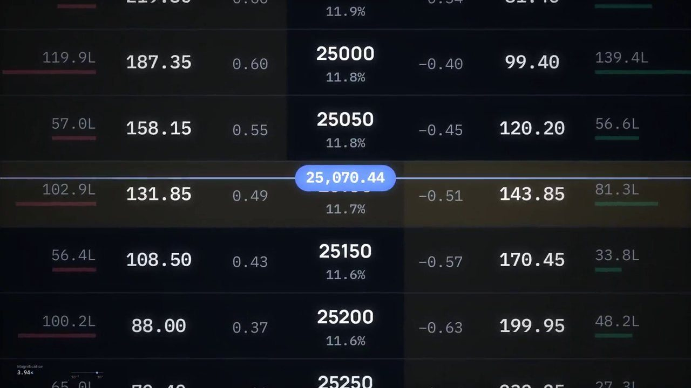</a> <a href="https://x.com/dale_vaz/status/2103290592679879074"></a></p>

Starts from a single dot, builds up charts, positions and an option chain, zooms out until the desktop is a point in space, then back in to a phone. A single shot.

- **Watch:** [the original post on X](https://x.com/dale_vaz/status/2103290592679879074) (23 likes, 2.8K views), posted 2026-09-25
- **Made by:** Dale Vaz ([@dale_vaz](https://x.com/dale_vaz)) with Claude Opus 5.5

**Prompt** (verbatim, in the post):

```text
create a self contained aesthetically pleasing, breathtaking animation of the Sahi Trading Terminal. it should start with a single dot on a black screen and then have multiple windows show up on the screen such as Charts, Positons , Option Chain, Watchlist. And zoom into and out at multiple scales. Finally the camera zooms out to make the desktop look like a point in space. And then it zooms back in to reveal a mobile screen in landscape mode with a chart in one half and an option chain in another. The video ends in Sjngle Screen Trading on SAHI
use javascript for it. be detailed and accurate. it should be visually stunning
```

<sub>Our score: 8/10 for design, polish and motion.</sub>

### AIsa: 5,000 API keys become one
<a id="aisa-one-key"></a>

<p><a href="https://x.com/0xfemyn/status/2103796337041137833"></a> <a href="https://x.com/0xfemyn/status/2103796337041137833"></a> <a href="https://x.com/0xfemyn/status/2103796337041137833"></a></p>

A swarm of 5,000 API key names collapses into a single orange key. One prompt, one shot.

- **Watch:** [the original post on X](https://x.com/0xfemyn/status/2103796337041137833) (9 likes, 669 views), posted 2026-09-26
- **Made by:** Rafael ([@0xfemyn](https://x.com/0xfemyn)) with Claude Opus 5.5

**Prompt** (verbatim, in the post):

```text
make a dynamic 15-second motion graphics video for AIsa. Go all out.
```

<sub>Our score: 8/10 for design, polish and motion.</sub>

### Flowdrive: stream in 4K, delivered everywhere
<a id="flowdrive-showreel"></a>

<p><a href="https://x.com/manuelogomigo/status/2103614667038052364"></a> <a href="https://x.com/manuelogomigo/status/2103614667038052364"></a> <a href="https://x.com/manuelogomigo/status/2103614667038052364"></a></p>

A dark, editorial film for a file-delivery product: layered terrain, a glowing dotted globe, then the custom domain. No skills, just the prompt; sound on.

- **Watch:** [the original post on X](https://x.com/manuelogomigo/status/2103614667038052364) (6 likes, 1.7K views), posted 2026-09-25
- **Made by:** [@manuelogomigo](https://x.com/manuelogomigo) with Claude Opus 5.5

**Prompt** (verbatim, in the post):

```text
make a dynamic 15-second motion graphics video that shows what an incredible motion designer you are, like it's your showreel for a flowdrive. go all out.
```

<sub>Our score: 8/10 for design, polish and motion.</sub>

### Matra: an Apple-style film for an app
<a id="matra-apple-style"></a>

<p><a href="https://x.com/gautam_mer1/status/2103703336780530003"></a> <a href="https://x.com/gautam_mer1/status/2103703336780530003"></a> <a href="https://x.com/gautam_mer1/status/2103703336780530003"></a></p>

An Apple-style 30-second film in Remotion and React: SF Pro type, a titanium iPhone, captions synced word by word to a real voice, and music.

- **Watch:** [the original post on X](https://x.com/gautam_mer1/status/2103703336780530003) (4 likes, 255 views), posted 2026-09-26
- **Made by:** Gautam ([@gautam_mer1](https://x.com/gautam_mer1)) with Claude Opus 5.5

**Prompt** (verbatim, in the post):

```text
an Apple-style 30s video of my app
```

<sub>Our score: 8/10 for design, polish and motion.</sub>

### No Hands Labs: companies that build themselves
<a id="no-hands-labs"></a>

<p><a href="https://x.com/robvjourney/status/2103768390322237474"></a> <a href="https://x.com/robvjourney/status/2103768390322237474"></a> <a href="https://x.com/robvjourney/status/2103768390322237474"></a></p>

Lime-on-black type and a dot-matrix 95% for a studio of AI-run companies.

- **Watch:** [the original post on X](https://x.com/robvjourney/status/2103768390322237474) (2 likes, 247 views), posted 2026-09-26
- **Made by:** iamrobinvv ([@robvjourney](https://x.com/robvjourney)) with Claude Opus 5.5

**Prompt** (verbatim, in the post):

```text
Can you make a 15-second motion graphic video of https://nohandslabs.com? Go ALL OUT and make the most badass video you possibly can use everything you've got.
```

<sub>Our score: 8/10 for design, polish and motion.</sub>

### norilu: hand off the work that keeps coming back
<a id="pen-designs-launch"></a>

<p><a href="https://x.com/sachaarbonel/status/2103614797501673648"></a> <a href="https://x.com/sachaarbonel/status/2103614797501673648"></a> <a href="https://x.com/sachaarbonel/status/2103614797501673648"></a></p>

Opus read the maker's designs through the pen.dev MCP and cut a calm, editorial launch film for his product norilu. The first try was rough; a blunt second prompt fixed the music and pacing.

- **Watch:** [the original post on X](https://x.com/sachaarbonel/status/2103614797501673648) (12 likes, 2.4K views), posted 2026-09-25
- **Made by:** [@sachaarbonel](https://x.com/sachaarbonel) with Claude Opus 5.5

**Prompt** (verbatim, in the post):

```text
Create a professional product launch video with motion graphics. You have access to the designs in pen

Follow-up:
It is better, but can you choose a royalty-free song online? You are clearly not a good song maker. Also, I would not hire you or pay you for this as a motion designer. This is not a professional-looking video. Also, it is a bit too fast and bumpy
```

<sub>Our score: 7/10 for design, polish and motion.</sub>

### Bento.surf: a 40-second product film
<a id="bento-surf"></a>

<p><a href="https://x.com/bizibeast/status/2103696876130505124"></a> <a href="https://x.com/bizibeast/status/2103696876130505124"></a> <a href="https://x.com/bizibeast/status/2103696876130505124"></a></p>

A playful phone-first product film for a link-in-bio page, made with a single prompt.

- **Watch:** [the original post on X](https://x.com/bizibeast/status/2103696876130505124) (7 likes, 689 views), posted 2026-09-26
- **Made by:** Yash Gawde ([@bizibeast](https://x.com/bizibeast)) with Claude Opus 5.5

**Prompt** (verbatim, in the post):

```text
Research
http://
Bento.surf. Make a dynamic 40-second motion graphics video on
http://
Bento.surf that shows what an incredible motion designer you are. like it's your showreel - Go all out.
```

<sub>Our score: 7/10 for design, polish and motion.</sub>

### QuickEmailVerify: stop bounces before you hit send
<a id="quickemailverify"></a>

<p><a href="https://x.com/KmAsiff/status/2103810247131549880"></a> <a href="https://x.com/KmAsiff/status/2103810247131549880"></a> <a href="https://x.com/KmAsiff/status/2103810247131549880"></a></p>

A SaaS-style film for an email verification tool, from typing an address to six possible answers and a cleaned list. Opus 5.5 on high effort.

- **Watch:** [the original post on X](https://x.com/KmAsiff/status/2103810247131549880) (3 likes, 180 views), posted 2026-09-26
- **Made by:** Khondokar MD Asiful Islam ([@KmAsiff](https://x.com/KmAsiff)) with Claude Opus 5.5

**Prompt** (verbatim, in the post):

```text
make a dynamic 20-second motion graphics video that shows what an incredible our email verify tool is, put all the use case you can imagine. go all out'
i want you to make it really modern and saas style. inspiration is yc videos and claude social videos
```

<sub>Our score: 7/10 for design, polish and motion.</sub>

### Orbe: everyday spending, in isometric 3D
<a id="orbe-everyday-spending"></a>

<p><a href="https://x.com/felipemoller/status/2103846311149936736"></a> <a href="https://x.com/felipemoller/status/2103846311149936736"></a> <a href="https://x.com/felipemoller/status/2103846311149936736"></a></p>

A vertical film for a Brazilian spending app: isometric scenes of a supermarket, a petrol station and a restaurant, each logging a purchase. JavaScript, Playwright and FFmpeg only; the maker says it took more than one prompt.

- **Watch:** [the original post on X](https://x.com/felipemoller/status/2103846311149936736) (1 likes, 246 views), posted 2026-09-26
- **Made by:** Felipe Möller ([@felipemoller](https://x.com/felipemoller)) with Claude Opus 5.5

**Prompt** (verbatim, in the maker's reply to the post):

```text
Use apenas: JavaScript, Playwright e FFmpeg. Faça um vídeo moderno, elegante e impactante para meu produto (https://lp.meuorbe.com.br). Quero que simule os gastos em estabelecimentos do dia a dia, como mercado, posto de gasolina e restaurante.

Faça no formato 9:16.
```

<sub>Our score: 7/10 for design, polish and motion.</sub>

### A pitch film for an Amazon wholesale business
<a id="winkz-pitch"></a>

<p><a href="https://x.com/ceowinkz/status/2103647124126683602"></a> <a href="https://x.com/ceowinkz/status/2103647124126683602"></a> <a href="https://x.com/ceowinkz/status/2103647124126683602"></a></p>

A 15-second pitch to brands, with price-protection and buy-upfront counters.

- **Watch:** [the original post on X](https://x.com/ceowinkz/status/2103647124126683602) (239 views), posted 2026-09-26
- **Made by:** Tyler ([@ceowinkz](https://x.com/ceowinkz)) with Claude Opus 5.5

**Prompt** (verbatim, in the post):

```text
make a dynamic 15 second motion graphics video pitching my Amazon wholesale company, Winkz Enterprises, to a brand. show why they should let us sell their products. go all out.
```

<sub>Our score: 7/10 for design, polish and motion.</sub>

### QueryGlow: a launch film in Anthropic's style
<a id="queryglow-launch"></a>

<p><a href="https://x.com/iamMXFSCHR/status/2103619221296955831"></a> <a href="https://x.com/iamMXFSCHR/status/2103619221296955831"></a> <a href="https://x.com/iamMXFSCHR/status/2103619221296955831"></a></p>

A quiet, serif launch film for a self-hosted database tool: open a URL, make it yours, works with Postgres, $79 once. The maker asked for something "a la Anthropic" in German and added music at the end.

- **Watch:** [the original post on X](https://x.com/iamMXFSCHR/status/2103619221296955831) (94 views), posted 2026-09-25
- **Made by:** Max ([@iamMXFSCHR](https://x.com/iamMXFSCHR)) with Claude Opus 5.5

**Prompt** (verbatim, in the post):

```text
nice. wir brauchen ein launch video für den release. kannst du das machen? so a la anthropic like? hab da was gelesen und der prompt war ""make a modern slick and punchy video for a modern startup that works on inference"
"""

"""
los, überrasch mich! hauptsache es geht viral
"""

"""
ja wo ist das video? i sehe nur eine .cinfig datei was als video abspielbar ist
"""

"""
können wir da noch eine trendige musik hinterlegen?
"""
```

<sub>Our score: 7/10 for design, polish and motion.</sub>

## Logo reveals and brand films

### An ad for Opus 5.5, after Apple's 1984
<a id="opus-1984-ad"></a>

<p><a href="https://x.com/1littlecoder/status/2103746736980378066"></a> <a href="https://x.com/1littlecoder/status/2103746736980378066"></a> <a href="https://x.com/1littlecoder/status/2103746736980378066"></a></p>

A runner with a hammer, rows of grey figures and a giant face on the screen: a 30-second homage made only from code. Opus even checked the sound levels.

- **Watch:** [the original post on X](https://x.com/1littlecoder/status/2103746736980378066) (56 likes, 3.5K views), posted 2026-09-26
- **Made by:** [@1littlecoder](https://x.com/1littlecoder) with Claude Opus 5.5

**Prompt** (verbatim, in the post):

```text
create a 30 second ad for Opus 5.5 inspired by Apple 1984 ad, iykyk! avoid the border text or frames!
```

<sub>Our score: 9/10 for design, polish and motion.</sub>

### PayBox: a brand sting from a logo
<a id="paybox-brand-sting"></a>

<p><a href="https://x.com/0xValure/status/2103603025579331584"></a> <a href="https://x.com/0xValure/status/2103603025579331584"></a> <a href="https://x.com/0xValure/status/2103603025579331584"></a></p>

From only the logo, the agent found the company, wrote the scenario and built a 10-second sting: wordmark wallpaper, a turning cube, then the lockup. One pass.

- **Watch:** [the original post on X](https://x.com/0xValure/status/2103603025579331584) (35 likes, 6.9K views), posted 2026-09-25
- **Made by:** Valure ([@0xValure](https://x.com/0xValure)) with Claude Opus 5.5

**Prompt** (verbatim, in the maker's reply to the post):

```text
Make this PayBox logo into a reel. Pretend you are a world-class motion designer. Make a 10-second dynamic video like the reference
```

<sub>Our score: 8/10 for design, polish and motion.</sub>

### PaymentForm: a logo built from low-poly shards
<a id="paymentform-logo-reveal"></a>

<p><a href="https://x.com/Mounnna/status/2103802871934497266"></a> <a href="https://x.com/Mounnna/status/2103802871934497266"></a> <a href="https://x.com/Mounnna/status/2103802871934497266"></a></p>

The logo is drawn as a wireframe, then faceted shards fly in one by one to assemble it, the app icon lands and the name types out, with sound.

- **Watch:** [the original post on X](https://x.com/Mounnna/status/2103802871934497266) (2 likes, 213 views), posted 2026-09-26
- **Made by:** Abdul kaioum ([@Mounnna](https://x.com/Mounnna)) with Claude Opus 5.5

**Prompt** (verbatim, in the maker's reply to the post):

```text
Create a motion design video of a slow-reveal transition. Draw the logo as a wireframe first, then fly in faceted low-poly shards one by one until they assemble the logo. Finish by bringing in the app icon background and typing out the brand name.
```

<sub>Our score: 8/10 for design, polish and motion.</sub>

### A retro-futuristic Opus 5.5 launch film
<a id="opus-retro-launch"></a>

<p><a href="https://x.com/johnsavage_ai/status/2103792769982427263"></a> <a href="https://x.com/johnsavage_ai/status/2103792769982427263"></a> <a href="https://x.com/johnsavage_ai/status/2103792769982427263"></a></p>

A glowing striped head with film grain and a CRT effect, from one prompt and one style reference image.

- **Watch:** [the original post on X](https://x.com/johnsavage_ai/status/2103792769982427263) (1 likes, 551 views), posted 2026-09-26
- **Made by:** John Savage ([@johnsavage_ai](https://x.com/johnsavage_ai)) with Claude Opus 5.5

**Prompt** (verbatim, in the maker's reply to the post):

```text
use this image only as a style/vibe refference image and create a Opus 5.5 launch video (20 sec long) add film grain and CRT effect, make it mesmerizing, and show off your skills as a motion designer for a retro/futuristic style launch video 16:9
```

<sub>Our score: 8/10 for design, polish and motion.</sub>

## Showreels and kinetic type

### A pelican riding a bicycle, made properly
<a id="pelican-riding-a-bicycle"></a>

<p><a href="https://www.xiaohongshu.com/explore/6af44c8b000000001f014c7a"></a> <a href="https://www.xiaohongshu.com/explore/6af44c8b000000001f014c7a"></a> <a href="https://www.xiaohongshu.com/explore/6af44c8b000000001f014c7a"></a></p>

Tired of the SVG pelicans every new model gets asked for, the maker asked for the most detailed one possible. A pelican rides a green bicycle down a pier at sunset: a flock overhead, a close-up of the chain and its feet on the pedals, its face, then a long shot down the jetty. Opus 5.5 wrote all of it in Claude Code: a Blender 5.2 scene rendered in Cycles, its own volumetric cloud renderer in Rust for a 12K sky, about 24,000 feathers, a bike with 36 spokes and 92 chain links, the animation, the music and the sound effects, with no ready-made models, textures or music. 792 frames at 1080p took about 42 seconds each on a 4 GB GTX 1650 Ti. The maker points out rough feathers and a flawed moment where the pelican eats a fish.

- **Watch:** [the original post on Xiaohongshu](https://www.xiaohongshu.com/explore/6af44c8b000000001f014c7a) (401 likes), posted 2026-11-11
- **Made by:** SugarV on Xiaohongshu, with Claude Opus 5.5

**Prompt** (verbatim, in the maker's [follow-up note](https://www.xiaohongshu.com/explore/6af55205000000002500af20), which gives it in English and Chinese):

```text
Every time a new model comes out, everyone has it draw "a pelican riding a bicycle" to judge its spatial ability, and it's almost always animated with HTML and SVG. I'm honestly tired of looking at them, so I want you to make the most complex, most detailed, most beautiful animated video of "a pelican riding a bicycle". You can use any technology. There's no rush; you can spend a whole day drawing it.
```

<sub>Our score: 9/10 for design, polish and motion.</sub>

### Phosphene: a psychedelic motion study
<a id="psychedelic-showreel"></a>

<p><a href="https://x.com/monokern/status/2103563538828832979"></a> <a href="https://x.com/monokern/status/2103563538828832979"></a> <a href="https://x.com/monokern/status/2103563538828832979"></a></p>

A giant eye, spinning rainbow tunnels, kaleidoscopes and chrome blobs, signed "a motion study by Claude"; motion and sound design both by Opus on extra-high effort: an hour and a half of rendering, $14 in all.

- **Watch:** [the original post on X](https://x.com/monokern/status/2103563538828832979) (57 likes, 4K views), posted 2026-09-25
- **Made by:** [@monokern](https://x.com/monokern) with Claude Opus 5.5

**Prompt** (verbatim, in the post):

```text
make a dynamic 20-second motion graphics video that shows what an incredible motion designer you are, psychedelic and hypnotic. make it feel like a showreel piece. go all out.
```

<sub>Our score: 9/10 for design, polish and motion.</sub>

### A poster breaking out of its own frame
<a id="poster-breaks-out"></a>

<p><a href="https://x.com/pankajkumar_dev/status/2103502614134718609"></a> <a href="https://x.com/pankajkumar_dev/status/2103502614134718609"></a> <a href="https://x.com/pankajkumar_dev/status/2103502614134718609"></a></p>

Big red and blue type punches through the frame of its own poster. Opus composed the soundtrack and synced every hit to the beat.

- **Watch:** [the original post on X](https://x.com/pankajkumar_dev/status/2103502614134718609) (39 likes, 4.5K views), posted 2026-09-25
- **Made by:** Pankaj Kumar ([@pankajkumar_dev](https://x.com/pankajkumar_dev)) with Claude Opus 5.5

**Prompt** (verbatim, in the post):

```text
create a motion design video of a poster breaking out of its own frame.
```

<sub>Our score: 9/10 for design, polish and motion.</sub>

### I CAN: blur, loop, render, swarm, bend light
<a id="i-can"></a>

<p><a href="https://x.com/zheke/status/2103418664854622583"></a> <a href="https://x.com/zheke/status/2103418664854622583"></a> <a href="https://x.com/zheke/status/2103418664854622583"></a></p>

A run of bold title cards, each one doing what it says: blurring, looping, rendering, swarming and bending light.

- **Watch:** [the original post on X](https://x.com/zheke/status/2103418664854622583) (22 likes, 7.6K views), posted 2026-09-25
- **Made by:** Eugene C ([@zheke](https://x.com/zheke)) with Claude Opus 5.5

**Prompt** (verbatim, in the post):

```text
Hello Opus 5.5 show me what an incredible motion designer you are.
```

<sub>Our score: 9/10 for design, polish and motion.</sub>

### One second on Earth
<a id="light-speed-earth"></a>

<p><a href="https://x.com/nolkeeg/status/2103841917603635633"></a> <a href="https://x.com/nolkeeg/status/2103841917603635633"></a> <a href="https://x.com/nolkeeg/status/2103841917603635633"></a></p>

Given zero direction and told to beat GPT 6 Astra, Opus chose its own subject: everything that happens in one second, from light circling the Earth seven times to 38 lightning bolts, four million tons of the Sun turning to light and four new people being born.

- **Watch:** [the original post on X](https://x.com/nolkeeg/status/2103841917603635633) (1 likes, 368 views), posted 2026-09-26
- **Made by:** Nolan Keegan ([@nolkeeg](https://x.com/nolkeeg)) with Claude Opus 5.5

**Prompt** (verbatim, in the post):

```text
Please do not reference any previous memories or skills. I've been seeing all of these motion graphics examples on X of people making cool videos with opus 5.5. So - I want you to just show off for me. You pick the design style, the look, subject etc. I just want to be extremely impressed by the motion graphic video that you create. I want you to destroy GPT 6 when it comes to motion graphics video - because astra just wants to give me a stupid glorified powerpoint presentation.
```

<sub>Our score: 9/10 for design, polish and motion.</sub>

### Claude, motion designer: a 15-second reel from one sentence
<a id="claude-motion-reel"></a>

<p><a href="https://www.xiaohongshu.com/explore/6ac7a32f000000001a02693d"></a> <a href="https://www.xiaohongshu.com/explore/6ac7a32f000000001a02693d"></a> <a href="https://www.xiaohongshu.com/explore/6ac7a32f000000001a02693d"></a></p>

A reel styled as a motion designer's portfolio: particle lettering, easing curves under the heading "Timing is everything", liquid type and an orange end card that tallies 899 frames, 8 scenes and 1 keyframe. From one sentence in Chinese, the same prompt that went around X.

- **Watch:** [the original post on Xiaohongshu](https://www.xiaohongshu.com/explore/6ac7a32f000000001a02693d) (2.3K likes), posted 2026-10-08
- **Made by:** 新旧 on Xiaohongshu, with Claude (the post doesn't name the model)

**Prompt** (verbatim, in the maker's reply to the post):

```text
做一段15秒的动效视频，展示你是个多么厉害的动效设计师，就像简历用的作品集，全力以赴。
```

<sub>Our score: 8/10 for design, polish and motion.</sub>

### A showreel with music synthesized from scratch
<a id="no-samples-showreel"></a>

<p><a href="https://x.com/prasenx/status/2103538744695693512"></a> <a href="https://x.com/prasenx/status/2103538744695693512"></a> <a href="https://x.com/prasenx/status/2103538744695693512"></a></p>

The maker knows nothing about motion design. Opus wrote the code for every frame and synthesized the music from scratch, no samples, in Cursor.

- **Watch:** [the original post on X](https://x.com/prasenx/status/2103538744695693512) (206 likes, 15.1K views), posted 2026-09-25
- **Made by:** Prasenjit ([@prasenx](https://x.com/prasenx)) with Claude Opus 5.5

**Prompt** (verbatim, in the maker's reply to the post):

```text
make a dynamic 15-second motion graphics video that shows what an incredible motion designer you are, like it's your showreel for a résumé. go all out.

compose the soundtrack yourself, fully synthesized in code. no samples, no audio files, no VST instruments. every cut and transition must land on the beat.

1920x1080, 60fps. render the final video with the music mixed in as an MP4 and tell me where it's saved.
```

<sub>Our score: 8/10 for design, polish and motion.</sub>

### I make things move: Motion Designer Claude
<a id="easing-explained"></a>

<p><a href="https://x.com/ChatGptAstra/status/2103834787647807540"></a> <a href="https://x.com/ChatGptAstra/status/2103834787647807540"></a> <a href="https://x.com/ChatGptAstra/status/2103834787647807540"></a></p>

Kinetic type that spins and snaps, a lesson in easing where linear motion turns into an ease-in-out curve, and an end card for "Motion Designer Claude". From a one-line Chinese prompt.

- **Watch:** [the original post on X](https://x.com/ChatGptAstra/status/2103834787647807540) (63 likes, 10.1K views), posted 2026-09-26
- **Made by:** 摸鱼巨匠 ([@ChatGptAstra](https://x.com/ChatGptAstra)) with Claude Opus 5.5

**Prompt** (verbatim, in the post):

```text
以动态设计师的高级审美，制作一段动态的15秒动态图形视频
```

<sub>Our score: 8/10 for design, polish and motion.</sub>

### A designer's portfolio, turned into a film
<a id="portfolio-film"></a>

<p><a href="https://x.com/heyiammallik/status/2103837803587293397"></a> <a href="https://x.com/heyiammallik/status/2103837803587293397"></a> <a href="https://x.com/heyiammallik/status/2103837803587293397"></a></p>

Opus went through every screen of the maker's portfolio and open source work and turned it into a bold, numbers-driven reel. One shot.

- **Watch:** [the original post on X](https://x.com/heyiammallik/status/2103837803587293397) (4 likes, 343 views), posted 2026-09-26
- **Made by:** Mallik Cheripally ([@heyiammallik](https://x.com/heyiammallik)) with Claude Opus 5.5

**Prompt** (verbatim, in the post):

```text
you are a pro motion designer. analyze my portfolio and make a ~30 second video from it. check what are the recent trending techniques used for motion and sound design. question your strategy and plan, if it doesn't feel like done by a pro designer, start over. every frame matters from the first frame to the final frame. go crazy
```

<sub>Our score: 8/10 for design, polish and motion.</sub>

### Rhythm, type, loops: it thinks in curves
<a id="it-thinks-in-curves"></a>

<p><a href="https://x.com/Ishaaqahamed/status/2103837917538107563"></a> <a href="https://x.com/Ishaaqahamed/status/2103837917538107563"></a> <a href="https://x.com/Ishaaqahamed/status/2103837917538107563"></a></p>

Square loops of colour-blocked type, then a bezier curve drawn live: Opus explaining that it doesn't keyframe, it writes the math.

- **Watch:** [the original post on X](https://x.com/Ishaaqahamed/status/2103837917538107563) (2 likes, 529 views), posted 2026-09-26
- **Made by:** [@Ishaaqahamed](https://x.com/Ishaaqahamed) with Claude Opus 5.5

**Prompt** (verbatim, in the maker's reply to the post):

```text
Make a dynamic 15-second motion graphics video that shows why [your product] is the best at [what it does], like a showreel. Go all out: 1080×1080, 1s hook, loop.
```

<sub>Our score: 8/10 for design, polish and motion.</sub>

### Hi, I'm Claude: Opus 5.5 introduces itself
<a id="who-are-you-opus"></a>

<p><a href="https://x.com/souravbhar871/status/2103711849703477361"></a> <a href="https://x.com/souravbhar871/status/2103711849703477361"></a> <a href="https://x.com/souravbhar871/status/2103711849703477361"></a></p>

Ten seconds of type that tells you what kind of model it is: "I read every word", "I think it through", "I tell it straight", "I build with you". The prompt asked it to avoid the corner frames and labels that give AI videos away.

- **Watch:** [the original post on X](https://x.com/souravbhar871/status/2103711849703477361) (120 views), posted 2026-09-26
- **Made by:** Sourav Bhar ([@souravbhar871](https://x.com/souravbhar871)) with Claude Opus 5.5

**Prompt** (verbatim, in the post):

```text
make a dynamic 10-second motion graphics video that shows who are you as Opus 5.5 - be as creative and dynamic as possible. Avoid the frames and texts on the corners which are typical ai made giveaways!
```

<sub>Our score: 8/10 for design, polish and motion.</sub>

### A 10-second film about the person asking
<a id="madhav-about-me"></a>

<p><a href="https://x.com/Madhav_XO/status/2103605007396524440"></a> <a href="https://x.com/Madhav_XO/status/2103605007396524440"></a> <a href="https://x.com/Madhav_XO/status/2103605007396524440"></a></p>

Asked for a video about whatever it knew of him, Opus built a particle film about the maker's work: multi-agent systems, zero-knowledge security, papers to production, and his name in chrome.

- **Watch:** [the original post on X](https://x.com/Madhav_XO/status/2103605007396524440) (7 likes, 241 views), posted 2026-09-25
- **Made by:** Madhav ([@Madhav_XO](https://x.com/Madhav_XO)) with Claude Opus 5.5

**Prompt** (verbatim, in the post):

```text
make a 10 sec video on whatever you know about me
```

<sub>Our score: 7/10 for design, polish and motion.</sub>

## Explainers

### Recursion, explained in nine genres
<a id="recursion-nine-styles"></a>

<p><a href="https://x.com/emollick/status/2103688362960019567"></a> <a href="https://x.com/emollick/status/2103688362960019567"></a> <a href="https://x.com/emollick/status/2103688362960019567"></a></p>

Every explanation of recursion switches to a radically different style, from a nature documentary to film noir. One prompt, a genuine one-shot: every scene drawn in React and SVG, the music and sound synthesized in Python.

- **Watch:** [the original post on X](https://x.com/emollick/status/2103688362960019567) (560 likes, 71.6K views), posted 2026-09-26
- **Made by:** Ethan Mollick ([@emollick](https://x.com/emollick)) with Claude Opus 5.5

**Prompt** (verbatim, in the post):

```text
A video explaining recursion, where every explanation about recursion has a radically different video style, make this self-referential & clever & fast moving.
```

<sub>Our score: 10/10 for design, polish and motion.</sub>

### A Negroni, poured step by step
<a id="negroni-recipe"></a>

<p><a href="https://x.com/Ror_Fly/status/2102853258582880547"></a> <a href="https://x.com/Ror_Fly/status/2102853258582880547"></a> <a href="https://x.com/Ror_Fly/status/2102853258582880547"></a></p>

A recipe explainer that fills the glass ingredient by ingredient with measurements, rendered in HTML from a single image.

- **Watch:** [the original post on X](https://x.com/Ror_Fly/status/2102853258582880547) (1K likes, 81.2K views), posted 2026-09-23
- **Made by:** Rory Flynn ([@Ror_Fly](https://x.com/Ror_Fly)) with Claude Opus 5.5

**Prompt** (verbatim, in the post):

```text
We're going to try a little test. Do you think you could render a recipe motion graphic animation using javascript or html (w/e you think will produce the best) to show the full recipe from start to finish (empty glass to completed cocktail) - Explainer video style - Showing the recipe ingreidents + measurements as they're going into the cup. Should be a 30s video.
```

<sub>Our score: 9/10 for design, polish and motion.</sub>

### 83 years of AI in under three minutes
<a id="history-of-ai"></a>

<p><a href="https://x.com/kloss_xyz/status/2103652674336067876"></a> <a href="https://x.com/kloss_xyz/status/2103652674336067876"></a> <a href="https://x.com/kloss_xyz/status/2103652674336067876"></a></p>

From ELIZA onwards: research, script, animation and real recorded sounds, all 5,160 frames coded by Claude from one prompt.

- **Watch:** [the original post on X](https://x.com/kloss_xyz/status/2103652674336067876) (197 likes, 10.7K views), posted 2026-09-26
- **Made by:** klöss ([@kloss_xyz](https://x.com/kloss_xyz)) with Claude Opus 5.5

**Prompt** (verbatim, in the post):

```text
make a video highlighting key moments in the history of AI.
```

<sub>Our score: 9/10 for design, polish and motion.</sub>

### How LLMs work, as a motion graphic (Fable 5.2)
<a id="how-llms-work-fable"></a>

<p><a href="https://x.com/MatthewBerman/status/2119868633086378471"></a> <a href="https://x.com/MatthewBerman/status/2119868633086378471"></a> <a href="https://x.com/MatthewBerman/status/2119868633086378471"></a></p>

Tokens, embeddings, attention and transformer layers, then disassembly and control flow, each as its own animated scene. Made with Claude Fable 5.2 in Matthew Berman's field test; he wrote that motion graphics are "completely solved".

- **Watch:** [the original post on X](https://x.com/MatthewBerman/status/2119868633086378471) (100 likes, 7.9K views), posted 2026-11-09
- **Made by:** [@MatthewBerman](https://x.com/MatthewBerman) with Claude Fable 5.2

<sub>Our score: 9/10 for design, polish and motion.</sub>

### A White Russian, poured in hand-drawn style
<a id="white-russian-recipe"></a>

<p><a href="https://x.com/Sarut0biSasuke/status/2103418429248069973"></a> <a href="https://x.com/Sarut0biSasuke/status/2103418429248069973"></a> <a href="https://x.com/Sarut0biSasuke/status/2103418429248069973"></a></p>

From a hand-drawn reference image: one prompt, no follow-ups, a 1080p MP4 about 25 minutes later. A single HTML file of SVG and plain JavaScript, no animation library.

- **Watch:** [the original post on X](https://x.com/Sarut0biSasuke/status/2103418429248069973) (22 likes, 1.3K views), posted 2026-09-25
- **Made by:** Sarutobi Sasuke ([@Sarut0biSasuke](https://x.com/Sarut0biSasuke)) with Claude Opus 5.5

**Prompt** (verbatim, in the post):

```text
Render a recipe motion graphic animation using JavaScript or HTML (whatever you think will produce the best result) to show the full recipe for a White Russian from start to finish, empty glass to completed cocktail. Explainer video style, showing the ingredients and measurements as they go into the glass. It should be a 30s video.
```

<sub>Our score: 8/10 for design, polish and motion.</sub>

## The prompt everyone copied

Many of the videos above started from the same short prompt, passed around X after Opus 5.5 came out. The base version:

```text
make a dynamic 15-second motion graphics video that shows what an incredible motion designer you are
```

What makers added to it, judging by the posts above:

- **Your product or site:** "...for &lt;website url&gt;", "The content should focus on [your product]. You should visit the pages first to learn about the product, then write the video content yourself."
- **A frame of reference:** "like it's your showreel", "Go all out", "like a premium developer-tool launch film", "a la Anthropic", "Apple-style".
- **A mood or a sound:** "psychedelic and hypnotic", "Use the Oppenheimer theme music as inspiration, but compose it yourself."
- **A guardrail:** "Avoid the frames and texts on the corners which are typical ai made giveaways!"
- **A reference:** a logo file, one image, a hand-drawn sketch or another video to match.

The longest prompts ([MakerMap](#makermap-one-shape), [TanStack AI](#tanstack-ai-launch)) are full briefs: inputs to ask for, motion rules and an export recipe (render every frame in headless Chrome, pipe into ffmpeg).

## How we pick and score

- The maker says the video was made with Claude (Opus 5.5, or Fable 5.2 where marked), as code.
- It has to look good: we watched every video and kept only the polished ones. The score (out of 10) is ours, for design, polish and motion.
- We opened every post and its replies by hand to check the prompt, the tools and any follow-up messages the maker mentions.
- Likes and views are what the original post showed when we checked it (November 12, 2026). Two videos are from Xiaohongshu (小红书), which shows likes but not views.
- The frames above are stills from each maker's own video, linked back to the post. Machine-readable list: [`data/videos.json`](data/videos.json).

## Add a video

Made a motion video with Claude, or found a great one? Open an issue or a pull request with the post link, and the prompt if it's public.

## Credits and removal

Every video and prompt belongs to its maker; this list only links to them and credits them. If you made one of these and want it changed or removed, open an issue and we'll do it the same day.

The list text and data in this repository are under the [MIT License](LICENSE). Maintained by [Crewmark](https://crewmark.ai?utm_source=github&utm_medium=readme&utm_campaign=awesome-claude-motion-video), which runs Claude Code and Codex as AI employees. Not affiliated with Anthropic.
